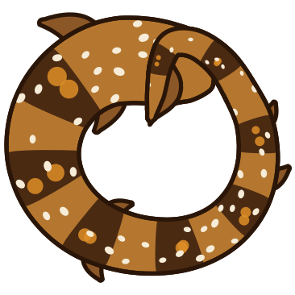
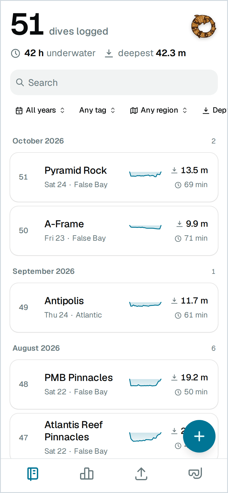
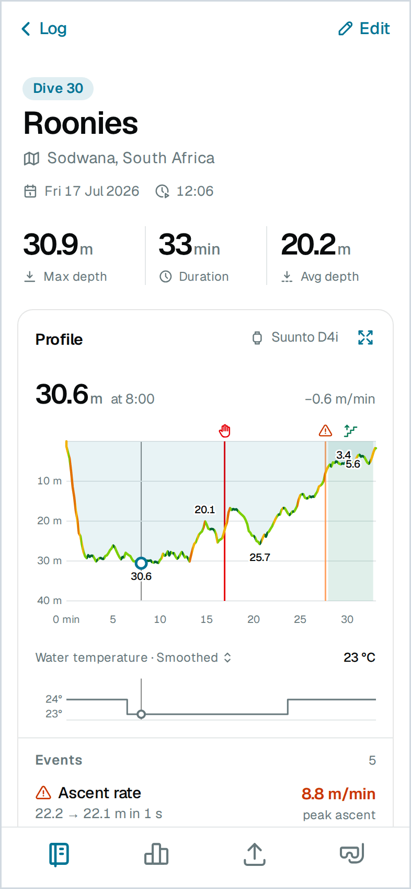
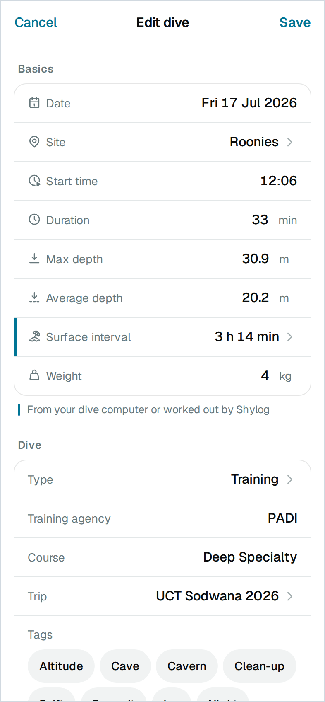
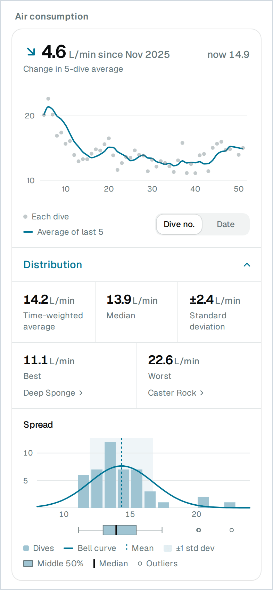
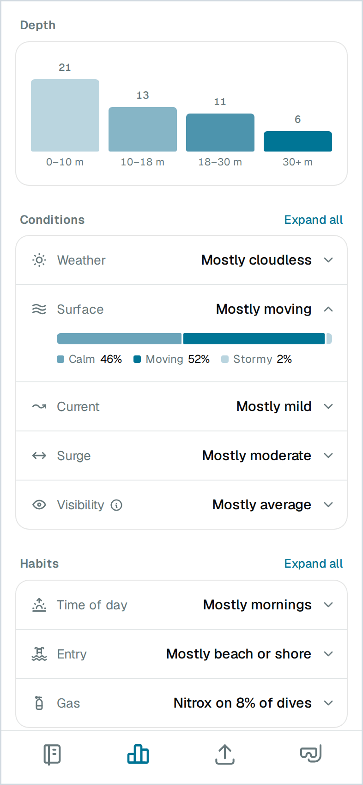
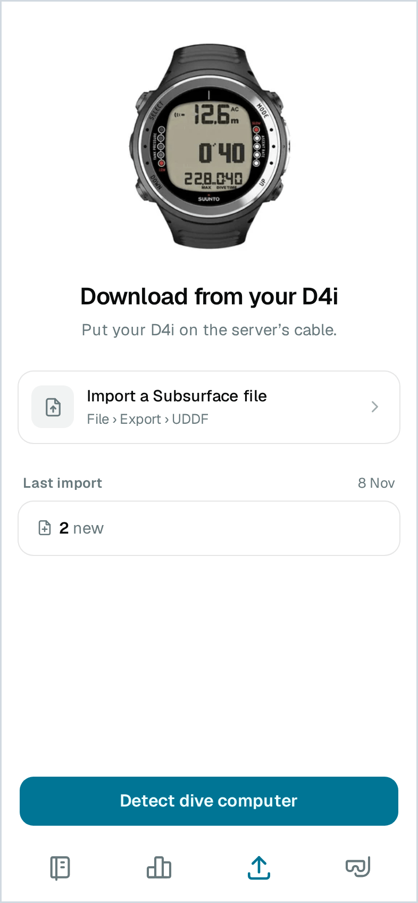
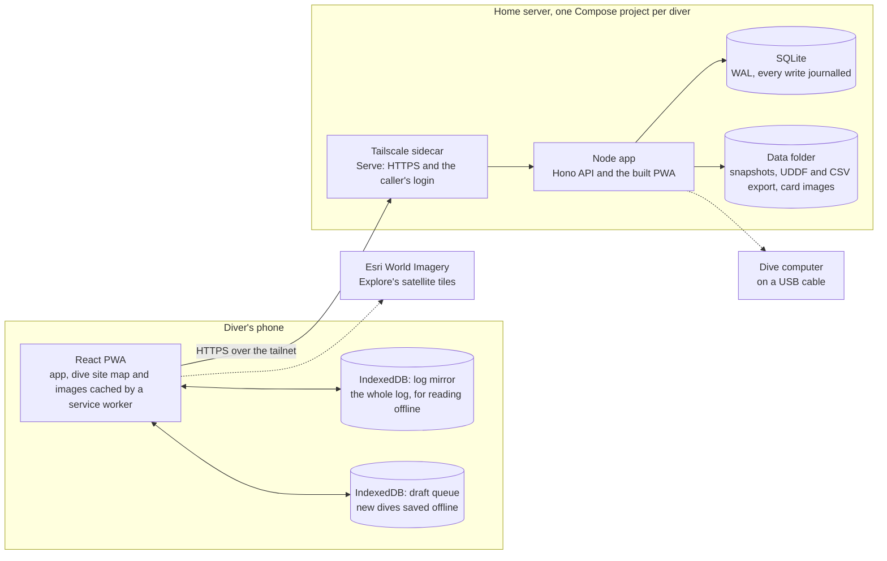

<h1> Shylog</h1>

[](https://github.com/tkabalin/shylog/actions/workflows/ci.yml)
[](LICENSE)
[](.nvmrc)
[](package.json)

A self-hosted, mobile-first web app for logging scuba dives. It runs on a home server, is reached only over Tailscale, and keeps its data in SQLite, with plain UDDF and CSV exports so the log is never locked in. Dive computer data arrives straight from the watch on a cable at the server, or as Subsurface UDDF exports, and is attached to the dives logged by hand.

[Subsurface](https://github.com/subsurface/subsurface) is the open-source dive log many divers rely on for the numbers, but it is a desktop app. Shylog is built to be filled in on a phone soon after the dive, with wet hands and often no signal, while giving the same figures Subsurface would.

<p>
  
  
  
</p>
<p>
  
  
  
</p>

- **[Calculations checked against Subsurface's own code](docs/calculations.md)**: Subsurface's functions are copied into [one small C++ program](packages/core/test/reference/subsurface.cpp) and run side by side with Shylog's TypeScript on thousands of random dives from [fast-check](https://fast-check.dev), aimed at the boundaries where bugs hide. Every rounded figure must match exactly, on every CI run.
- **[UDDF that other apps can open](docs/export.md)**: the UDDF Shylog writes is checked in CI against the official [UDDF 3.2.1 schema](fixtures/uddf/uddf_v321.xsd), with each departure from it listed in [export.md](docs/export.md). CI also opens it with Subsurface's own import and checks that each dive comes out the same, gas and cylinders included, so a log moved to Subsurface arrives intact.
- **[Built not to lose a dive](docs/server.md)**: SQLite in WAL mode with `STRICT` tables, every write one journalled transaction, a snapshot before each migration, and an integrity check that pauses writes if it fails.
- **[Hand beats computer](docs/import.md)**: each field records whether it was typed or read from the dive computer, so an import never overwrites a hand-entered value and keeps the computer's reading beside it.
- **[Private by design](docs/security.md)**: no accounts or passwords. The app is reachable only over Tailscale and trusts its identity header for an allow-listed login.
- **[Designed for wet hands](docs/ui.md)**: phone first, with 44 px touch targets, bottom navigation, 16 px inputs so iOS doesn't zoom, and native date and number keyboards.

> [!NOTE]
> Shylog is built around its author's own diving rather than as a general-purpose dive log. Downloading from a dive computer and importing Subsurface exports are written and tested only for the Suunto D4i and Zoop Novo, and the app's choices follow the diving it was made for, around Cape Town. If you would like to run Shylog yourself, consider forking it and adapting it to your own dive computer and diving.

## What it does

- Log, edit and delete dives from a phone, with new dives saved offline as drafts that sync when there is signal.
- Show the log, each dive's details and a profile chart of depth, temperature, vertical speed, the safety stop and the computer's alarms.
- Download the dives from a Suunto D4i or Zoop Novo on a USB cable at the server, or import a Subsurface export, and pair each computer dive with the dive logged by hand.
  - The import rules are written and tested for the Suunto D4i and Zoop Novo; other computers' exports go through generic rules that are untested.
- Work out SAC rate, MOD, max PO₂, CNS and OTU, surface intervals and statistics across the whole log, with the patterns worth knowing about picked out and a celebration at each dive-number milestone.
- Export the whole log as UDDF and CSV each night, or download either from You.
- Keep sites, people, dive centres, trips and certification cards, with the cards viewable offline.
- Find somewhere to dive around Cape Town on Explore: a map of the Cape Peninsula and False Bay's 409 dive sites from Wikivoyage, found by type, depth, shore or boat, the wind and swell, season, the skills a site asks for and what it's good for, each with its page, site maps and sonar images, the marine protected areas' zones and who may dive where, and a satellite view. A dive's site can be picked from them, filled in from the map. The map, pages and images stay on the phone for a boat with no signal, and an instance for a diver elsewhere can turn Explore off.
- Keep a packing checklist to tick off before a dive.
- Install to the home screen, with one instance per diver.
- Work with the log from Claude Code and Claude Desktop, through an MCP server on the tailnet: look a dive up by its number, search past dives, log and edit dives, tidy sites, people, dive centres and trips, and search Explore's dive sites.

## Architecture



Solid arrows are the request path, from the phone through Tailscale to the database; the dotted arrows are the download from the dive computer through `dctool` and the one call that leaves the tailnet, Explore's satellite tiles straight from Esri; cylinders are data stores.

The phone keeps a mirror of the whole log, so the app opens and reads without signal, and a separate queue for dives logged offline. A sync brings the mirror up to date but never touches the queue, so a dive saved without signal can't be lost to a refresh. Drafts upload when there is signal and the server applies each one whole or not at all; edits to dives already on the server are plain API calls. The app container shares the Tailscale sidecar's network and listens nowhere else, so the only way in is Tailscale Serve, which tells the app who is calling. See [docs/offline-sync.md](docs/offline-sync.md) for the sync rules and [docs/security.md](docs/security.md) for the identity checks.

## Tech stack

| Area    | Tools                                                                                                  |
| ------- | ------------------------------------------------------------------------------------------------------ |
| Web app | React 19, Vite, TanStack Router, Tailwind CSS 4, shadcn/ui, Recharts, MapLibre, Dexie, vite-plugin-pwa |
| Server  | Node 24, Hono with its typed RPC client, better-sqlite3, @xmldom/xmldom, tsup                          |
| Shared  | TypeScript, Zod schemas used by both the app and the server                                            |
| Testing | Vitest, fast-check, Playwright on Chromium and WebKit, `xmllint` and `xsltproc` for UDDF checks        |
| Deploy  | Docker Compose with a Tailscale sidecar, HTTPS through Tailscale Serve                                 |

See [docs/tech-stack.md](docs/tech-stack.md) for versions and the reasons behind each choice.

The design and engineering decisions are written up in [`docs/`](docs/): the [tech stack](docs/tech-stack.md), [data model](docs/data-model.md), [offline sync](docs/offline-sync.md), [server and durability](docs/server.md), [security](docs/security.md), [import](docs/import.md), [export](docs/export.md), [calculations and the profile chart](docs/calculations.md), [statistics](docs/statistics.md), [UI](docs/ui.md), [testing](docs/testing.md) and [CI](docs/ci-cd.md). The full spec, the build plan and the original wireframes are in [`docs/planning/`](docs/planning/).

## Development

Needs Node 24 (see `.nvmrc`), pnpm (which Corepack provides), a C++ compiler (`c++`, as from `build-essential` or Xcode's command line tools) and `xsltproc` and `xmllint` (`apt install xsltproc libxml2-utils`; macOS has both) for the Subsurface reference and UDDF schema tests.

```bash
corepack enable
pnpm install
cp .env.example .env    # then set the values below
pnpm dev                # web on http://localhost:5173, server on PORT (3000)
pnpm seed               # optional: load the fixture's dives into an empty log
pnpm test               # unit and integration tests
```

`.env.example` is written for a deployment. For local development, set:

```bash
SHYLOG_ALLOWED_LOGINS=you@example.com
SHYLOG_DEV_LOGIN=you@example.com       # stands in for the Tailscale login
SHYLOG_ORIGIN=http://localhost:5173
SHYLOG_DATA_DIR=/absolute/path/to/shylog-data   # any folder outside the repo
```

`pnpm dev` runs the server with `NODE_ENV=development`. Without it the server counts as production and refuses to start with `SHYLOG_DEV_LOGIN` set.

## Deploying

Each diver gets an instance: the app and a Tailscale sidecar, run as one Compose project from the image CI publishes to `ghcr.io/tkabalin/shylog`. The app listens only inside the sidecar's network, so Tailscale Serve is the only way in, and everything an instance keeps is under its `SHYLOG_DATA_DIR`.

### What you need

- A Linux server with Docker Engine and the Compose v2 plugin (`docker compose version` answers), and git.
- A Tailscale account. Once, in the admin console, turn on MagicDNS and HTTPS certificates.
- An auth key for each instance's `TS_AUTHKEY`, from the admin console's Settings, Keys, Generate auth key. A one-off key is enough. Don't make it ephemeral, or the node leaves the tailnet whenever the sidecar stops.

### Setting up an instance

For each instance on the home server:

```bash
git clone https://github.com/tkabalin/shylog.git && cd shylog   # once
sudo install -d -o 1000 -g 1000 /srv/shylog/<instance>            # the image runs as uid 1000
mkdir -p instances && cp .env.example instances/<instance>.env    # git ignores instances/
```

Edit `instances/<instance>.env`, where comments explain each value. Each instance needs its own `COMPOSE_PROJECT_NAME`, `TS_HOSTNAME` and `SHYLOG_DATA_DIR`, all under `/srv/shylog/`, which the off-site backup should cover (see [Backups and restores](#backups-and-restores)). Then start it:

```bash
docker compose --env-file instances/<instance>.env up -d
```

Once the node has joined, clear `TS_AUTHKEY` and disable key expiry for the node in the admin console.

If you set up an instance for another diver, share its node with their Tailscale account and restrict each node to its diver's devices in the tailnet policy.

### Tailnet policy

The app only answers logins in `SHYLOG_ALLOWED_LOGINS` (see [docs/security.md](docs/security.md) for the checks behind that), and the tailnet policy can keep everyone else from reaching the node at all. The default policy lets every device reach every other, so replace its allow-all grant with rules like these, plus whatever your other devices need. Each node is named by its Tailscale IP (`docker compose --env-file instances/<instance>.env exec tailscale tailscale ip -4`), which needs no tag on the auth key, and someone you shared a node with is named by their login:

```jsonc
{
  "hosts": {
    "shylog": "100.64.0.1", // your instance
    "shylog-buddy": "100.64.0.2", // the second diver's, shared with them
  },
  "grants": [
    // You reach both, for support.
    {
      "src": ["diver@example.com"],
      "dst": ["shylog", "shylog-buddy"],
      "ip": ["tcp:443"],
    },
    // The second diver reaches only theirs.
    {
      "src": ["buddy@example.com"],
      "dst": ["shylog-buddy"],
      "ip": ["tcp:443"],
    },
  ],
}
```

### Smoke test

Every `/api` request needs an `X-Shylog` header, and Tailscale Serve sends the caller's login, which must be in `SHYLOG_ALLOWED_LOGINS`. From a device on the tailnet:

```bash
curl -H 'X-Shylog: 1' https://<TS_HOSTNAME>.<tailnet>.ts.net/api/health
```

If the host doesn't use MagicDNS, add `--resolve <TS_HOSTNAME>.<tailnet>.ts.net:443:<node IP>`, with the node IP from `docker compose --env-file instances/<instance>.env exec tailscale tailscale ip -4`. A request without the header gets `403 Missing X-Shylog`, and one from a login that isn't allowed gets `403 Login not allowed`. To check the refusal, take your login out of `SHYLOG_ALLOWED_LOGINS`, run `up -d --wait app`, repeat the request, then put it back. For the second diver, install the app on their phone through the shared node: the app sends the header on every call, so it loading proves their login passes.

### Claude

Each instance serves an MCP server at `/mcp`, so Claude Code or Claude Desktop on a device on the tailnet can look dives up by number, search the log, log and edit dives, and search Explore's dive sites and read their pages. Deleting stays in the app. It takes the same allowed login as the app. Add it to Claude Code once per instance:

```bash
claude mcp add --transport http --scope user shylog-<instance> https://<TS_HOSTNAME>.<tailnet>.ts.net/mcp
```

Claude Desktop reaches it through an extension, packed for each instance on a computer with this repo:

```bash
pnpm --filter @shylog/claude-desktop extension <instance> https://<TS_HOSTNAME>.<tailnet>.ts.net/mcp
```

This writes `apps/claude-desktop/shylog-<instance>.mcpb`. Copy it to the computer running Claude Desktop and install it from Desktop's Settings > Extensions > Advanced settings > Install Extension. Windows doesn't open the file with Desktop on a double-click. It runs on Desktop's own Node and connects from that computer, so Tailscale has to be on there. Pack one per instance: each gets its own name, so they sit side by side.

Claude on the phone, claude.ai and Desktop's own connectors can't use it: they connect from Anthropic's cloud, which can't reach the tailnet. If Claude Code shows the server as needing authentication, the server refused the login, as it does for a login not in `SHYLOG_ALLOWED_LOGINS` or a tagged device; there is no sign-in to give it.

### Dive computer cable

With the watch's USB cable plugged into the server, Import can download the dives itself. The image includes `dctool` for the Suunto D4i and Zoop Novo, and the cable needs no driver, as Linux's own `ftdi_sio` shows it as a serial port. Once per server, make a group for the cable and install the udev rule that names it `/dev/suunto` and gives it to that group:

```bash
sudo groupadd --system suunto
sudo install -m 644 udev/99-suunto.rules /etc/udev/rules.d/
sudo udevadm control --reload && sudo udevadm trigger --subsystem-match=tty
```

Plug the cable in (the watch need not be on it) and check it shows up:

```bash
sudo dmesg | tail -n 5         # "FTDI USB Serial Device converter now attached to ttyUSB0"
ls -l /dev/suunto /dev/ttyUSB*  # /dev/suunto -> ttyUSB0, which is crw-rw---- root suunto
getent group suunto             # its id is the third field
```

To turn downloading on for an instance, add these to its env file, with the `suunto` group's id, and run `docker compose --env-file instances/<instance>.env up -d`:

```bash
COMPOSE_FILE=compose.yml:compose.dive-computer.yml
SHYLOG_DC_GID=<the suunto group's id>
```

`compose.dive-computer.yml` lets the app open the cable: it sees the host's `/dev` at `/host/dev` (without its submounts, needing Docker Engine 25 and Compose 2.26 or later; check with `docker version` and `docker compose version`), may open USB serial devices, and joins the `suunto` group. Without it, Import offers only the upload and the instance can't reach the cable. With several instances on one server, add it to each one that should download: they share the one cable, each remembers the first watch it downloads from and refuses another, and Forget on You clears that for a new watch. One downloads at a time: while one instance reads the watch, another's Detect says the cable is busy.

The cable can be plugged in and out while the containers run, so there is nothing to restart.

#### When Import doesn't see the watch

1. The cable shows as `/dev/suunto` on the host (`ls -l /dev/suunto`). If not, check `dmesg` and the udev rule.
2. The instance has the cable: `docker compose --env-file instances/<instance>.env config` lists `/host/dev` under the app's volumes. If not, check `COMPOSE_FILE` in its env file.
3. The app sees it: `docker compose --env-file instances/<instance>.env exec app ls -lL /host/dev/suunto`.
4. It belongs to `suunto`, and `SHYLOG_DC_GID` matches that group's id on this host.
5. The watch's battery isn't low and it sits firmly in the cable's clip, which forum reports blame for most failed Suunto downloads.
6. The watch is awake: press a button and try again.

### Satellite imagery

Explore's satellite view shows Esri's World Imagery, which needs a free [ArcGIS Location Platform](https://location.arcgis.com/) account (no card) and a key for each instance's `SHYLOG_ARCGIS_KEY`. Without one the map has no satellite view. To make the key:

1. In the account's Developer credentials, choose New item, then API key credentials, then a private application with selected privileges.
2. Tick only Location services, Basemaps, and leave item access empty.
3. Under referrer restrictions add the instance's `SHYLOG_ORIGIN`, plus `http://localhost:5173` for development, where `pnpm dev` reads the key from `.env` when it starts.
4. The key lasts a year at most. Once Esri refuses it, Explore says "Esri refused the satellite key" and the app's log has a `client_error` line saying the key was refused: make a new key then, the same way.

Then run `docker compose --env-file instances/<instance>.env up -d`. Installed apps keep the page they installed with, so a new or changed key reaches a phone with the app's next update: set it before updating to a new image, and change it while the old one still works. The free tier is 2 million basemap tiles a month. Leave pay-as-you-go off, so going over stops the imagery rather than billing. The key is in the app's page, which anyone who can reach the instance can read, as every map tile carries it to Esri anyway; at worst someone spends the month's free tiles.

### Updating

```bash
git pull && scripts/update.sh <instance>
```

The image comes from GHCR. `git pull` updates the clone's `compose.yml`, `tailscale/` and `scripts/` so they match it. `update.sh` does nothing if the image hasn't changed. Otherwise it takes a snapshot, starts the new image and rolls back to the old one if it isn't healthy within three minutes. After a migration a rollback isn't possible, so the app is left stopped with the restore command to run. It exits 0 when updated or current, 3 when rolled back and 1 when stopped.

If Docker restarts the sidecar on its own and the app stops answering, run `up -d` again.

### Logs

The app writes one JSON object per line to stdout, so `docker compose --env-file instances/<instance>.env logs app` shows them, and any Docker log shipper, such as Grafana Alloy into Loki, picks them up with no configuration here. Rotation is Docker's, set by `log-opts` in the daemon's `daemon.json`.

Every line has `time`, `level`, `event`, `msg`, `instance` (the `TS_HOSTNAME`) and `version` (the commit the image was built from). Each `/api` and `/mcp` request logs one `request` line with `method`, `route`, `path`, `status`, `durationMs` and `requestId`, the id the app sends with every call and gets back in `X-Request-Id`; a refused request adds its `reason`. The app's own errors arrive as `client_error` lines carrying the `failedRequestId` of the call that failed, and each MCP tool call logs an `mcp_tool` line with the tool, its `outcome` and `durationMs`. Logs hold ids, counts and timings, never what a diver wrote.

Some LogQL, with the shipper labelling each container:

```logql
# Errors and warnings from one instance
{container=~".*shylog.*"} | json | instance="shylog" and level=~"error|warn|fatal"

# Everything about one request, from the phone's report to the server's line
{container=~".*shylog.*"} | json | requestId="<id>" or failedRequestId="<id>"

# Requests slower than half a second
{container=~".*shylog.*"} | json | event="request" and durationMs > 500
```

## Backups and restores

Each night at midnight in `TZ`, an instance writes `snapshots/shylog-<date>.db.gz` to its data folder, keeping dailies for 90 days, weeklies for two years and monthlies forever. The off-site backup must cover `/srv/shylog/`, which holds every instance's snapshots, card images and the nightly export (`export/dives.uddf` and `export/dives.csv`). How the journal, snapshots and replay fit together is in [docs/server.md](docs/server.md).

- `scripts/backup.sh <instance>` takes a snapshot now.
- `scripts/restore-drill.sh <instance>` restores last night's snapshot to a scratch folder, replays the journal and reports any difference. It never writes to the live database.
- `scripts/restore.sh <instance> <snapshot> [--replay-to <seq>|all]` restores a snapshot, moving the current database to `restore-aside/`. It takes a nightly snapshot or one of the `pre-migration-*.db` copies the server makes before each migration.

### Restoring

1. Pick a snapshot from `/srv/shylog/<instance>/snapshots`: the latest, or for bad data the last one before it.
2. For bad data, find the last good journal entry (times are UTC):

   ```bash
   docker compose --env-file instances/<instance>.env exec app node apps/server/dist/cli.js journal --since 2026-10-22
   ```

3. Restore, replaying up to that entry, everything (`all`) or nothing (no option):

   ```bash
   scripts/restore.sh <instance> shylog-2026-10-22.db.gz --replay-to 1234
   ```

If the replay fails, the app is left stopped with the old database in `restore-aside/`. If every snapshot is lost, import the UDDF export in `export/` into a new instance.

## Licence

Licensed under [GPL-3.0-or-later](LICENSE).

The dive sites in `apps/web/src/map/sites.geojson` and their text in `apps/web/src/map/pages.json` come from Wikivoyage's [Dive sites](https://en.wikivoyage.org/wiki/Diving_the_Cape_Peninsula_and_False_Bay/Dive_sites) list for the Cape Peninsula and False Bay and the pages it links to, by Wikivoyage's contributors, under [CC BY-SA 4.0](https://creativecommons.org/licenses/by-sa/4.0/). They are converted from wikitext to GeoJSON and Markdown, cut down, and corrected in places (`apps/web/scripts/map/site-fixes.json`), with how to get in to each site read from its page (`apps/web/scripts/map/page-fixes.json`).

The site maps, sonar images, aerial photos and wreck plans in `apps/web/src/map/images/` come from [Wikimedia Commons](https://commons.wikimedia.org/), each under its own licence, which `apps/web/src/map/image-credits.json` names with its author and its Commons page, and the app shows under the image. Most are by Peter Southwood or Wreckless Marine under CC BY-SA 3.0 or 4.0. They are resized and re-encoded as WebP.

The image includes `dctool` from [libdivecomputer](https://www.libdivecomputer.org), licensed under LGPL-2.1, built from its [0.9.0 release](https://github.com/libdivecomputer/libdivecomputer/releases/tag/v0.9.0) with [one patch](docker/libdivecomputer/stop-events.patch) (see the `Dockerfile`). Its licence, the patch and where its source is are in the image under `/usr/share/doc/libdivecomputer/`.
