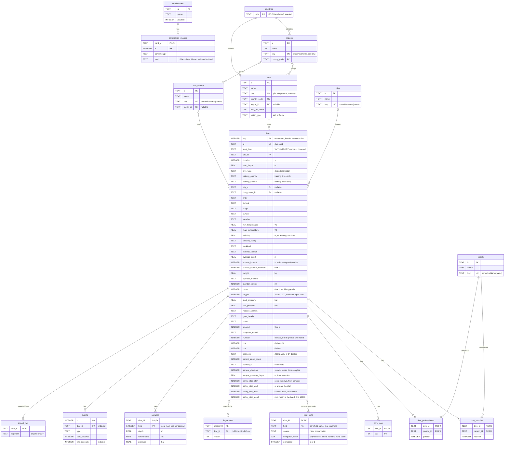
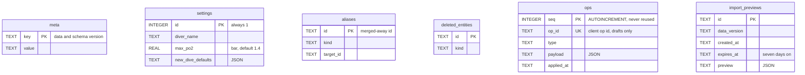

# Database schema

The SQLite schema as built by the migrations in `apps/server/src/db/migrations/`. Columns are in database units (see Units in [SPEC.md](SPEC.md)): metres, seconds, °C, bar, millilitres, and oxygen in tenths of a per cent. Times are local wall-clock strings with no zone.

## Logbook

Foreign keys to a dive point at `dives.id`, not its `seq` primary key.

## Bookkeeping

These tables have no foreign keys. `aliases.target_id` is deliberately not one, as a target can itself be merged away later and resolves transitively.

