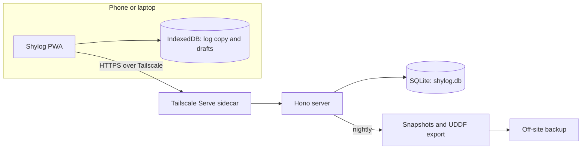

# Shylog spec

## Overview

**Name (provisional)**: Shylog, with a shyshark as the app icon. Also used for the repo and the tailnet hostname, `shylog`. The icon (`docs/design/shylog-icon.svg`) is a puffadder shyshark on Tailwind cyan-700, drawn full bleed with the shark inside the maskable safe zone, so iOS and Android can apply their own corner shape.

A mobile-first PWA for logging dives, self-hosted on a home server and reachable only over Tailscale. Data lives in a SQLite database on the server, and a plain UDDF copy of the whole log is exported nightly and on demand, so the data is never locked into the app.

**Status**: ready for development. The remaining open items are listed under Open questions.

**Subsurface as a reference**: Shylog is not a recreation of Subsurface, but Subsurface's open-source code ([subsurface/subsurface](https://github.com/subsurface/subsurface)) is a useful reference. When building Shylog, Claude can check it for ideas or advice on technical problems such as profile scaling, sample handling, UDDF, and dive computer data, so problems it has already solved are not solved again. The profile chart rules in this spec came from `core/profile.cpp` and `profile-widget/`.

### In scope for v1

- Add, edit, and delete dives. New dives can be logged offline and sync later; changing a synced dive needs a connection
- Dive list, dive detail with a time series profile chart (depth, temperature, and computer events), and aggregate statistics
- Attaching the dive computer's time series from a Subsurface UDDF export to hand-logged dives, for the Suunto D4i and the Suunto Zoop Novo
- Managing sites, people, dive centres, and trips
- Certification cards, viewable offline
- A second instance for a second diver
- Installable on a phone home screen

### Not in v1

- Bulk editing
- MCP integration for logging dives with Claude
- Downloading directly from the dive computer
- Several divers in one instance, or public access (the second diver gets a separate instance; see Instance configuration)

## Stack and deployment

Everything is TypeScript, so one core package (draft upload and edit schemas, name normalisation, unit conversion, and calculations) is shared by the browser and the server. All choices are confirmed.

| Layer | Choice | Notes |
| --- | --- | --- |
| UI components | React with shadcn/ui, preset `b1sAmWaNW`, with cyan as the theme and chart colour | Touch-size overrides on mobile, compact sizes from `md:` up. A thin Shylog theme layer overrides the preset's CSS variables only where needed (surfaces, the dark-mode accent, and Geist Mono; the preset brings Geist) |
| Routing | TanStack Router | File-based routes with typed links and search params |
| Build and PWA | Vite with vite-plugin-pwa | Precaches the app shell; installable |
| Charts | shadcn charts (Recharts) | Matches the theme; switch the profile chart to uPlot if long dives feel slow |
| Local storage | IndexedDB via Dexie | Read-only JSON copy of the log (without samples) plus unsynced draft dives, and the samples and card images fetched so far, cached for offline viewing |
| Server | Node 24 (LTS) with TypeScript and Hono | Applies draft uploads and edits, serves the app, handles imports and the UDDF export |
| Database | SQLite in WAL mode via better-sqlite3 (not Node's built-in `node:sqlite`) | Source of truth: one file, `shylog.db` |
| UDDF | @xmldom/xmldom on the server | Reads Subsurface imports and writes the nightly UDDF export |
| Repo layout | pnpm workspace: `apps/web`, `apps/server`, `packages/core` | Shared types, draft upload and edit schemas, name normalisation, and calculations |
| Data | `shylog.db` on a bind mount, plus `export/dives.uddf` and `cards/` | The UDDF export is rewritten nightly with the snapshot; all are backed up |
| Access | Tailscale only, no app login | Only the devices of the instance's diver (plus the owner's for support, where allowed), enforced by tailnet ACLs and an identity check |
| Deployment | Docker Compose on the home server: the app and a Tailscale sidecar | Own tailnet name with HTTPS via Tailscale Serve |
| Units | Metric everywhere | SI only inside the UDDF export |

### Instance configuration

Nothing in the code or the Compose file assumes a single deployment, so the second diver's instance is a new env file rather than a code change. v1 runs two instances, one per diver, and everything that differs between them comes from configuration:

- **Identity**: the allowed Tailscale logins are a list in config (`SHYLOG_ALLOWED_LOGINS`), checked against `Tailscale-User-Login`. No login is hard-coded. The owner's login is allowed on both instances, the second diver's only on theirs. For development, `SHYLOG_DEV_LOGIN` supplies a login in place of the header, and the server refuses to start with it set in production.
- **Hostname and origin**: the tailnet hostname (`TS_HOSTNAME`, default `shylog`) and the expected `Origin` (`SHYLOG_ORIGIN`) are config, so the security checks work under any name.
- **Data directory**: one root per instance (`SHYLOG_DATA_DIR`, such as `/srv/shylog/<instance>/`) holds `shylog.db`, `export/`, the nightly snapshots, and `cards/`. No other path appears in the code. Every instance lives under one parent folder that the nightly off-site backup job covers.
- **Compose**: no fixed `container_name`, published ports, or named volumes. Each instance is its own Compose project (`COMPOSE_PROJECT_NAME`) with its own `.env`, and the Tailscale sidecar keeps its state on a bind mount at `${SHYLOG_DATA_DIR}/tailscale`. All instances run the same image tag, which CI builds and publishes to GitHub's container registry once the checks pass on `main`, so one pull updates them all, and each runs its own migrations on startup.
- **App name**: the display name (`SHYLOG_APP_NAME`) sets the page title and the web app manifest, which the server serves rather than the build baking in, so two installed apps on one phone are told apart.
- **Diver details**: the owner written to the UDDF export's diver section comes from Settings, not the code.
- **Scripts**: the restore drill and backup scripts take the instance name as an argument.
- **Dive computer**: Suunto import rules (clock offset, freedive detection, Subsurface placeholders) sit in one module covering the D4i and the Zoop Novo, with model-specific rules where the two differ. The module is chosen by the computer model the export names, so any other computer falls back to the generic rules.
- **Second instance**: the second diver's logbook is the same image run as its own Compose project (such as `shylog-<name>`) with its own data directory, database, UDDF export, and Tailscale sidecar. Its node is shared with the second diver's Tailscale account, and its allowed logins are theirs, optionally plus the owner's for support. The separate hostname gives it a separate origin, so the two apps' offline stores never mix. Serve sends `Tailscale-User-Login` for users on a shared node too ([Tailscale Serve](https://tailscale.com/kb/1312/serve)), so the identity check works for the second diver; the Deploy step smoke-tests it. A login with non-ASCII characters arrives Q-encoded (RFC 2047), so the check decodes it before comparing.

## Architecture

The browser works offline for reading the log and logging new dives, and the server owns the data: each device keeps a read-only copy of the log plus any draft dives not yet uploaded, and the server writes changes to the SQLite database in transactions, journals every write, and exports a plain UDDF copy nightly.



Both sides import `packages/core`, so request validation, name normalisation, and calculations behave identically in the browser and on the server. UDDF is parsed and written only on the server.

## Data model

The SQLite database on the server is the source of truth. UDDF is the format data arrives in (Subsurface imports) and leaves in (the nightly export), not where it lives.

### Database

- `dives`: one row per dive with every field in the tables below, in database units, plus the dive computer's model (from the import), the surface interval override flag, and `deleted_at`.
- `field_meta`: one row per dive field with a recorded source, holding `(dive_id, field, source, computer_value, dismissed)`. `source` is hand or computer, `computer_value` holds the computer's reading once a hand value replaces it, and `dismissed` records that you chose to keep your value. Both stay through later hand edits until the computer value is adopted, even when the hand value comes to match it. Clearing a field by hand stores an empty hand value when a computer value is kept, so an import never refills it; clearing one with no computer value removes its row, so average depth and temperatures are calculated from the samples again. This is what the import rules read.
- `fingerprints`: one row per computer dive an import has seen, holding the fingerprint, the dive it belongs to (none for a freedive left out), and why it was recorded.
- `samples`: profile samples per dive (time, depth, temperature, tank pressure), loaded on demand.
- `events`: warnings and flags the dive computer recorded during the dive, each with its start time in the dive, an end time when it spans an interval, and its type, loaded on demand with the samples. From the D4i these are ascent-rate alarms and surfacings (see What the D4i export contains under Subsurface import); the Zoop Novo is assumed to match.
- `sites`, `countries` (seeded with the ISO 3166 list), `regions`, `people` (anyone who appears on a dive as a buddy or dive professional), `dive_centres`, and `trips`.
- `certifications`: certification cards, each a name and its images, which are files in `cards/`. Each image row keeps a short SHA-256 of its bytes, so the phone can tell a changed page from an unchanged one, and the file is named by it (`cards/<card id>/<hash>`), so a change writes its new files before committing and removes unused ones only after, and a crash never leaves the database naming a missing or wrong file.
- `settings`: log-wide settings: the diver's name, the maximum PO₂ setting, and the new-dive defaults.
- Link tables for multi-valued fields, such as `dive_buddies`, `dive_professionals`, and `dive_tags`.
- `aliases`: ids left by merges, so a draft that still points at a merged-away site or person resolves; the merged-away row is deleted.
- `deleted_entities`: the id and kind of every deleted site, region, person, dive centre, and trip, so a re-sent draft that still names one is rejected rather than bringing it back, and a repeated delete changes nothing.
- `ops`: the journal of every write, with a server sequence number and apply time, which is also the record of applied op ids.
- `import_previews` (stored previews awaiting confirmation, expiring after seven days) and `import_raw` (each imported dive's original UDDF fragment).
- `meta`: the data version and schema version.

Foreign keys and unique constraints enforce integrity on every write. Unique keys cover sites (normalised name within a country), countries, regions (normalised name within a country), people, dive centres, trips, and fingerprints (covering live and deleted dives and freedives left out). People must have a unique name, normalised the same way as sites (ignoring case, spacing, accents, and curly versus straight quotes), so no two people can share a name. A person carries no role: on each dive they are added either as a buddy or as a dive professional. Two real people with the same name are told apart by adding a surname or nickname, and the pick list offers the existing person when a typed name matches. Oxygen fractions are stored as integers in tenths of a per cent (324 is 32.4%) and cylinder volumes in millilitres, so grouping identical gases and cylinders for the export never compares floating-point numbers.

### Rules for edits

- Dives, sites, regions, people, dive centres, trips, and certification cards have stable ids generated on the client, such as `dive-<uuid>`. All ids start with a letter, so they are valid UDDF ids in the export too.
- Deleting a dive sets `deleted_at`. Deleted dives appear only in Recently deleted, are left out of the log and the UDDF export, and are never purged, so any of them can be restored and their fingerprints keep blocking re-imports.
- A trip can be deleted, which unlinks its dives. A site, region, person, or dive centre can be deleted only while nothing uses it, counting dives in Recently deleted (and, for a region, sites and dive centres); otherwise it is merged into another. Nothing is deleted automatically, and every delete is journalled.
- Merging moves everything that uses the merged-away entity onto the survivor. Two regions merge only within one country. Where a dive has both people being merged, the survivor keeps the role and place it already had on that dive (buddy or dive professional), since one person can't be both on a dive.
- Changing a region's country moves its sites to that country too, rechecking their names there, since a site's region is always in the site's country.
- Cylinder material, cylinder volume, and oxygen percentage are plain columns on each dive, so changing one dive never affects another. The export groups dives with the same material and volume into one UDDF tank, and dives with the same oxygen fraction into one gas mix, so 32.4% nitrox never shares a mix with 32%.
- Schema changes go through numbered migrations, each preceded by a database snapshot (skipped for a new, empty database) and journalled.

### UDDF export

Nightly, alongside the database snapshot, the server writes the whole log to `export/dives.uddf`: to a temp file in the same folder, fsynced, re-parsed to confirm it is valid, then renamed over the previous export. Downloading from Settings builds a fresh one, which also replaces `export/dives.uddf` and updates the time of the last export. It is plain UDDF that opens in Subsurface without Shylog, every dive in its own repetition group.

- Per-dive data with no UDDF element (surface, weather, rough visibility rating, maximum water temperature, gear details, tags, dive centre) goes in `<applicationdata><shylog>` under Shylog's own XML namespace.
- **Standard data is passed through**: standard UDDF elements from an imported dive that Shylog doesn't model or show (such as extra sample channels, deco stops, and alarms) are written back into their normal places in the export, in schema order and with links remapped to Shylog ids, so Subsurface and other tools read them as usual. Where a field Shylog models has a hand value that differs from the computer's, the standard element carries the hand value.
- Each exported dive keeps its Shylog id, so the export is stable from night to night. There is no separate restore-from-UDDF path: Shylog is restored from database snapshots, and if those were ever all lost, the export could come back in through the normal import, losing only the hand-versus-computer markers.
- The op journal itself isn't exported; it is backed up with the database.

UDDF provides `<applicationdata>` for exactly this: program-specific data that parsers pass through without interpreting, with each program using its own child element. It is optional and appears once per dive, so Shylog adds its child to an existing `<applicationdata>` rather than creating a second. The official schema only lists registered child names, so the file may fail strict XSD validation; registering `shylog` with the UDDF maintainer would fix that. Other tools may drop the element on export, which does not matter because Shylog's database is the master. ([UDDF 3.2.1: applicationdata](https://www.streit.cc/extern/uddf_v321/en/applicationdata.html))

### Units

| Quantity | Database | App | UDDF export |
| --- | --- | --- | --- |
| Depth, altitude, visibility | metres | metres | metres |
| Temperature | °C | °C | kelvin |
| Pressure | bar | bar | pascals |
| Duration, surface interval | seconds | minutes, or hours and minutes | seconds |
| Tank volume | millilitres (integer) | litres | cubic metres |
| Weight | kg | kg | kg |
| Gas mix | tenths of a per cent (integer; 324 = 32.4%) | % to one decimal place | fraction from 0 to 1 |
| Latitude and longitude | decimal degrees | decimal degrees | decimal degrees |

### v1 fields

Four fields are required, as is the oxygen percentage when Nitrox is yes, and the dive number is derived; everything else is optional. All units are metric. The last column says where each value goes in the UDDF export: `<shylog>` is Shylog's per-dive block, and "database only" means it isn't exported but is kept in the database backups. Unset choices are left out of the export rather than written as UDDF's unknown values, and defaults are written when a dive is saved.

| Field | Input | Notes | UDDF export |
| --- | --- | --- | --- |
| Dive number | Shown only, never edited | Chronological position across all dives that aren't ignored, by local start time, recalculated by the server after every change; two dives with the same start time keep the order they were written in. An ignored dive has no number | `informationbeforedive/divenumber`, left out for an ignored dive |
| Date and time | Date and time pickers | Local time at the site, stored as one field, `YYYY-MM-DDTHH:mm:ss` with no offset (a hand-logged time gets `:00` seconds) | `informationbeforedive/datetime`, local time with no UTC offset |
| Site | Pick or create | Matched ignoring case, spacing, and accents within the same country, so "Long Beach" and "long beach " are one site but a Long Beach elsewhere is not. Curly quotes and apostrophes match straight ones, since iOS types ’ by default, so "Simon’s Town" and "Simon's Town" are one site; the stored name keeps what was typed. Rename and merge in Settings | `informationbeforedive/link` to `divesite/site` |
| Duration | Minutes |  | `informationafterdive/diveduration` |
| Max depth | Metres |  | `informationafterdive/greatestdepth` |

Each site stores, once rather than per dive: a country, picked from a fixed list (ISO 3166), and optionally a region such as Cape Town or Sodwana, typed with the existing regions in that country offered as you type, and deduplicated like sites within its country (UDDF `geography`); a body of water (UDDF `environment`: Ocean or sea, Lake or quarry, River or spring, Cave or cavern, Pool, Hyperbaric chamber, Under ice, Other, with aquariums under Other, written as `ocean-sea`, `lake-quarry`, `river-spring`, `cave-cavern`, `pool`, `hyperbaric-chamber`, `under-ice`, and `other`); and, in the database only, a water type (Salt or Fresh, defaulting to Salt and switching to Fresh for Lake or quarry, River or spring, and Pool). Regions are entities of their own: they can be created offline by a draft, and renamed, merged, and deleted like sites.

Buddies, dive professionals, dive centres, and trips are stored once each and picked from a list, and a dive centre can have a region. In the export, dive professionals are UDDF buddies (whether a person was a buddy or a dive professional on a dive stays in the database), dive centres are UDDF `divebase` entries linked from each dive's `<shylog>` because UDDF has no per-dive link for them, and trips appear as UDDF's `tripmembership`, which holds the trip's name. Renaming or merging any of these in Settings rewrites the links and records an alias, so late offline ops still resolve.

Tags are a fixed list in the app code, not editable in the app. Each dive stores a tag's stable key (such as `night`), so a label can change in code without touching the data. Removing a tag from the code needs a small migration that maps or drops its key. Every choice field works the same way: the database stores Shylog's own key for each option (such as `veryMild` for Current), and `packages/core` maps it to the UDDF string where UDDF has the field, so one naming style covers fields with and without a UDDF element.

**Time zones**: dive times are stored as local wall-clock time at the site, with no zone or UTC offset, as Subsurface does, so a 9am dive in Hoi An is stored and shown as 9am. Ordering, dive numbers, surface intervals, and CNS carry-over use these local times directly. That would only go wrong for two dives within 48 hours in different time zones, which doesn't happen in practice.

| Optional field | Input | Options or unit | Default | UDDF export |
| --- | --- | --- | --- | --- |
| Dive type | Choice | Recreation, Training, Scientific, Medical, Commercial, Military, Competitive, Other | Recreation | `informationafterdive/program`: `recreation`, `training`, `scientific`, `medical`, `commercial`, `military`, `competitive`, `other` |
| Training agency | Free text, shown only when Dive type is Training; kept while editing if the type changes, but only saved when the type is Training | e.g. PADI, SSI |  | `<shylog>` |
| Training course name | Free text, shown only when Dive type is Training; kept while editing if the type changes, but only saved when the type is Training | e.g. Advanced Open Water, Deep Specialty |  | `<shylog>` |
| Tags | Multiple choice from a fixed list hardcoded in the app | Starting list: Altitude, Cave, Cavern, Clean-up, Drift, Dry suit, Ice, Night, Pelagic, Photo/video, Search and recovery, Wreck |  | Tag keys in `<shylog>` |
| Trip | Pick or create | e.g. Vietnam 2026 |  | `informationbeforedive/tripmembership` (name); id in `<shylog>` |
| Buddies | Pick or create, several allowed |  |  | `informationbeforedive/link` to `diver/buddy` |
| Dive professionals | Pick or create, several allowed | Instructors, divemasters, and guides, with no finer role |  | `informationbeforedive/link` to `diver/buddy`; being a professional is kept in the database only |
| Dive centre | Pick or create |  |  | `divesite/divebase`, linked from `<shylog>` |
| Entry | Choice | Beach or shore, Pier, Small boat, Charter boat, Liveaboard, Barge, Landside, Hyperbaric facility, Other |  | `informationbeforedive/platform`: `beach-shore`, `pier`, `small-boat`, `charter-boat`, `live-aboard`, `barge`, `landside`, `hyperbaric-facility`, `other` |
| Current | Choice | None, Very mild, Mild, Moderate, Hard, Very hard. Water flowing in one direction, separate from surge |  | `informationafterdive/current`: `no-current` to `very-hard-current` |
| Surge | Choice | None, Mild, Moderate, Hard, Very hard. The strongest back-and-forth push from swell felt during the dive: Mild is a slight sway, Moderate needs finning or a handhold to stay put, Hard makes holding position difficult, Very hard makes it impossible |  | `<shylog>` |
| Surface | Choice | Calm, Moving, Stormy |  | `<shylog>` |
| Weather | Choice | Cloudless, Cloudy, Rainy |  | `<shylog>` |
| Minimum water temperature | Number | °C | Filled from the profile samples on import when empty | `informationafterdive/lowesttemperature` |
| Maximum water temperature | Number | °C | Filled from the profile samples on import when empty | `<shylog>` (UDDF has no maximum) |
| Visibility | Number, or a rough rating when unsure (one or the other) | metres, or Low, Average, High |  | Metres in `informationafterdive/visibility`; rating in `<shylog>` |
| Workload | Choice | Resting, Light, Moderate, Severe, Exhausting |  | `informationafterdive/workload` |
| Thermal comfort | Choice | Comfortable, Cold, Very cold, Hot |  | `informationafterdive/thermalcomfort`: `comfortable`, `cold`, `very-cold`, `hot` |
| Average depth | Number | metres | Imported from the export's `averagedepth` as a computer value; calculated from the profile samples (time-weighted, leaving out segments at the surface, as Subsurface does) only when the export has no `averagedepth` but has samples. Hand values still win, as for every field | `informationafterdive/averagedepth` |
| Surface interval before | Duration | hours and minutes | Calculated as Subsurface does (`get_surface_interval` in `core/divelist.cpp`): from the end of the dive that started most recently before this one, a dive ending at its start plus the later of its duration and its last sample below the surface. If that dive was still going when this one started, the interval is 0; over 48 hours, or with no earlier dive, it is recorded as no previous dive, a cap Shylog keeps although Subsurface has none. Can be overridden | `informationbeforedive/surfaceintervalbeforedive`: `passedtime` in seconds, or `<infinity/>` |
| Weight | Number | kg |  | `informationafterdive/equipmentused/leadquantity` |
| Cylinder material | Choice | Steel, Aluminium |  | Stored on the dive; the export groups identical material and volume into one tank in the owner's equipment, linked from the dive's `tankdata`. It describes a cylinder type, not a specific cylinder, so rental tanks work the same as owned ones |
| Cylinder volume | Number | litres |  | `tankdata/tankvolume` |
| Nitrox | Yes or no | No means air (20.9%, as in Subsurface) | No | The oxygen fraction of a gas mix in `gasdefinitions`, linked from `tankdata`. Stored on the dive (32.4% as 324); the export groups dives with the same fraction into one mix |
| Oxygen percentage | Number to one decimal place (e.g. 32.4), shown only when Nitrox is yes, and then required so every nitrox dive has a known gas mix | % |  | As above |
| Start pressure | Number | bar |  | `tankdata/tankpressurebegin` |
| End pressure | Number | bar |  | `tankdata/tankpressureend` |
| SAC rate | Calculated, read-only | litres per minute |  | Not stored |
| CNS | Calculated, read-only | % at the end of the dive, including carry-over from earlier dives | From the profile samples and gas; blank without samples | Database only (derived) |
| OTU | Calculated, read-only | Oxygen toxicity units for the dive | From the profile samples and gas; blank without samples | Database only (derived) |
| MOD | Calculated, read-only | metres | From the dive's gas mix and the maximum PO₂ setting | Not stored |
| Max PO₂ | Calculated, read-only | bar | From max depth and the dive's gas mix | Not stored |
| Notable animals | Free text |  |  | `informationafterdive/observations/notes` |
| Gear details | Free text |  |  | `<shylog>` |
| Notes (labelled General in the app, under the Notes heading) | Free text |  |  | `informationafterdive/notes` |
| Ignored (labelled Ignore this dive) | Yes or no | For a dive that shouldn't count towards the log, such as a pool session, an aborted dive, or a hyperbaric chamber run; any reason will do | No | `<shylog>` |

**New-dive defaults**: Settings holds log-wide defaults for cylinder material and volume, start pressure, gas, weight, dive type, and how visibility is entered (metres or rating), filled into every new dive. They use the same controls as the dive form (material, volume in litres, and Nitrox with its oxygen percentage), not a fixed list. A filled-in default counts as a hand value, like anything typed.

**Ignored dives**: an ignored dive has no dive number, so the dives after it are numbered as if it weren't there, and it is left out of the Log's header and month counts, every Statistics figure, chart, and pattern, and the figures on sites, people, dive centres, and trips. Otherwise it is an ordinary logged dive: it shows in the Log and search, can be edited, is exported, and still counts for surface intervals and CNS carry-over, since the body doesn't know the dive was ignored. The dive count in `/api/health` and Settings includes it, as that count guards against lost data. Only a hand edit sets it: new-dive defaults, Copy from last dive, and imports never do.

### Calculations

#### Depth and pressure

Every calculation below converts depth to pressure as Subsurface does (`calculate_depth_to_mbarf` in `core/dive.cpp`). Pressure in mbar is the surface pressure plus the depth in mm × density × 0.981 / 100,000, where density is in grams per 10 litres: 10,300 for salt water and 10,000 for fresh, from the site's water type. That is 0.101043 bar per metre in salt water (about 9.90 m per bar) and 0.0981 bar per metre in fresh (about 10.19 m per bar). Surface pressure comes from UDDF `surfacepressure` when present, otherwise 1,013 mbar, so altitude dives are handled. As in Subsurface (`SURFACE_THRESHOLD`), anything shallower than 0.75 m counts as at the surface, except that time under water and the average depth from samples (`fixup_dc_duration`) also count a sample of exactly 0.75 m as at the surface, as Subsurface's code does. Ambient pressures and PO₂ values are rounded to whole mbar, as Subsurface does, so Shylog's figures can be checked against Subsurface's for the same dive.

#### SAC rate

SAC rate follows Subsurface's `calculate_sac` (`core/divelist.cpp`). It is calculated only for single-cylinder dives with start and end pressure, cylinder volume, duration, and an average depth (typed, imported from the dive computer, or calculated from samples), and only when the start pressure is above the end pressure. Each pressure is turned into litres of gas at 1 atm (1,013 mbar, as Subsurface rounds it) using the gas mix's compressibility factor Z, so full cylinders no longer read a few per cent high as they would with an ideal gas. The gas used is then divided by the ambient pressure at the average depth (in atm) and by the duration. Duration and average depth are the dive's effective values: a hand-entered value wins, as everywhere. Otherwise, when the dive has samples, they come from the samples as Subsurface works them out (`fixup_dc_duration` in `core/divecomputer.cpp`): time under water, and the time-weighted mean depth in whole mm, both leaving out segments where both samples are at the surface. This departs from Subsurface, which always uses the samples, so a dive with a hand-entered duration or average depth can show a different SAC. Subsurface's rounding is kept: each gas volume to whole millilitres, the ambient pressure to whole mbar, and the result to whole millilitres per minute. Nitrox affects SAC only through Z.

```math
\begin{aligned} \text{SAC} &= \frac{V_{\text{gas}}(P_{\text{start}}) - V_{\text{gas}}(P_{\text{end}})}{t_{\text{min}} \times P_{\text{amb}}(d_{\text{avg}}) / 1.013}, \qquad V_{\text{gas}}(P) = \frac{V_{\text{cyl}} \times P / 1.013}{Z(P)} \\ Z(P) &= 1 + \sum_{g \in \{O_2,\, N_2\}} F_g \left(c_{g,1} P + c_{g,2} P^2 + c_{g,3} P^3\right), \qquad P \text{ in bar, clamped to } 0 \text{ to } 500 \end{aligned}
```

Z uses Subsurface's cubic virial fit (`gas_compressibility_factor` in `core/gas-model.cpp`). For oxygen the coefficients are −7.18092073703 × 10⁻⁴, 2.81852572808 × 10⁻⁶, and −1.50290620492 × 10⁻⁹; for nitrogen, −2.19260353292 × 10⁻⁴, 2.92844845532 × 10⁻⁶, and −2.07613482075 × 10⁻⁹. Nitrogen is everything that isn't oxygen, since Shylog has no helium.

#### MOD and max PO₂

MOD and max PO₂ are calculated for single-cylinder dives with a known gas mix (air, 20.9% oxygen as in Subsurface, when Nitrox is no), using the depth and pressure conversion above. MOD follows Subsurface's `gas_mod` (`core/dive.cpp`): the pressure at the maximum PO₂ setting is the limit in mbar × 1000 divided by the oxygen fraction in tenths of a per cent, in integer arithmetic, converted to a depth in whole mm, then rounded down to 0.1 m, except that a value within 0.01 m of the next step rounds up. The 0.1 m step is Shylog's own: Subsurface's cylinder table rounds to 1 m, so it shows 33 m where Shylog shows 33.2 m. The maximum PO₂ setting is 1.4 bar by default, changeable in Settings, and stored on the server for the whole log. It should match the dive computer's own PO₂ setting so Shylog agrees with the computer's alarm, so Shylog keeps 1.4 bar rather than Subsurface's default of 1.6. Max PO₂ assumes the dive's one gas was breathed at max depth, and is highlighted when it exceeds the maximum PO₂ setting.

```math
\text{MOD} = \frac{PO_{2,\text{max}} / F_{O_2} - P_{\text{surface}}}{w}, \qquad PO_{2,\text{dive}} = F_{O_2} \times \left(P_{\text{surface}} + w \, d_{\text{max}}\right), \qquad w = 0.101043 \text{ bar/m (salt)}, \; 0.0981 \text{ bar/m (fresh)}
```

#### CNS and OTU

CNS and OTU are calculated by the server from the profile samples and the dive's gas, following Subsurface's `calculate_cns_dive`, `calculate_cns`, and `calculate_otu` (`core/divelist.cpp`), and stored as derived values, since the D4i's own figures aren't in its export. Both work segment by segment, a segment being the time between two consecutive samples, with the PO₂ at each end (in whole mbar) from that sample's depth as above. Subsurface's integer arithmetic is kept: the CNS segment's mean PO₂ and the OTU's scaled segment time are truncated to whole numbers. Dives without samples show neither, and the figures can differ slightly from what the D4i displayed.

**CNS**: a segment counts only if its mean PO₂ (the average of its two ends) is above 500 mbar. It adds its length in seconds times a rate from Subsurface's two-line fit to the log of the NOAA table, with one line up to 1,500 mbar and another above, times 100 for a percentage. Carry-over follows Subsurface: from the dive, Shylog walks back through earlier dives for as long as each ended no more than 12 hours before the next one started, and if the dive belongs to a trip, dives in other trips are skipped. It then walks forward from the earliest of those, halving the running total for every 90 minutes of surface interval (from one dive's end to the next one's start) and adding each dive's own CNS, ending with this dive. A dive's end is its start plus the later of its duration and the time of its last sample below the surface. Earlier dives without samples add nothing. The stored figure is rounded to a whole per cent.

**OTU**: a segment counts if either end is above 500 mbar. When one end is at or below 500 mbar, only the part above counts: the segment's time is scaled by the share of the PO₂ change that lies above 500 mbar, and that end is treated as 501 mbar. Each segment then adds a third-order approximation of Baker's equation 2 for changing PO₂. OTU is per dive, with no carry-over, rounded to a whole number.

```math
\begin{aligned} \text{CNS}_{\text{seg}} &= 100 \, t_{\text{s}} \times \begin{cases} e^{-11.7853 + 0.00193873 \, \overline{PO_2}} & \overline{PO_2} \le 1500 \\ e^{-23.6349 + 0.00980829 \, \overline{PO_2}} & \overline{PO_2} > 1500 \end{cases}, \qquad \overline{PO_2} = \frac{PO_{2,\text{start}} + PO_{2,\text{end}}}{2} \\ \text{OTU}_{\text{seg}} &= \frac{t_{\text{s}}}{60} \, p^{5/6} \left(1 - \frac{5 \, (PO_{2,\text{end}} - PO_{2,\text{start}})^2}{216\,000\,000 \, p^2}\right), \qquad p = \frac{PO_{2,\text{start}} + PO_{2,\text{end}}}{1000} - 1 \\ \text{CNS}_{\text{after interval}} &= \text{CNS}_{\text{before}} \times 2^{-t_{\text{surface}} / 90\,\text{min}} \end{aligned}
```

PO₂ is in mbar and segment time t in seconds.

## Operations and offline sync

New dives are drafts on the device until they upload, and can be logged, edited, and deleted with no connection. Drafts upload as operations (ops), which are safe to apply twice, so lost responses and resends can never duplicate or drop a dive. Every other change (editing, deleting, or restoring a synced dive; creating, renaming, merging, or deleting entities in Settings; changing settings; and managing certification cards) is an ordinary API call that needs a connection; see Edits to synced data.

```ts
type Base = { opId: string; opVersion: number; deviceId: string; at: string };

// Ops are used only to upload offline drafts; edits to synced data are plain API calls.
// Tanks and gas mixes are created by the server from dive fields, so they have no ops.
type EntityKind = 'site' | 'region' | 'person' | 'diveCentre' | 'trip';

type Op =
  | (Base & { type: 'upsertEntity'; kind: EntityKind; id: string; fields: Record<string, unknown> })
  | (Base & { type: 'upsertDive'; diveId: string; fields: DiveFields }); // buddies, diveProfessionals, and tags as id lists in fields
```

### Flow

1. A new dive is saved to IndexedDB as a draft, with its `upsertDive` op, plus an `upsertEntity` op for any site, region, person, dive centre, or trip it creates, queued in the same Dexie transaction. Until it uploads, editing the draft rewrites those queued ops, and deleting it removes them. The queue has its own schema version, so newer app code can migrate drafts written by older code.
2. Changes to synced data are plain API calls (see Edits to synced data). Offline, the controls for them are disabled, with a note that a connection is needed.
3. When the server is reachable, the client uploads drafts one at a time, oldest first, each as one request to `POST /api/ops` carrying that draft's ops.
4. The server rejects an unsupported `opVersion` (it accepts the current and previous versions), skips any `opId` already recorded, and applies the rest of the draft in one transaction, so a draft is saved whole or not at all.
5. The server records the accepted ops in the ops journal, commits, and only then replies with the result, the new version, and its current time.
6. The client drops the draft's ops once they are accepted or already applied. A rejected draft stays on the device with the reason shown on its card; editing it queues it again with new `opId`s, and it can also be deleted.
7. If the version changed, the client fetches the log and re-applies any drafts still in its queue on top. Fetching the whole log (without samples) on any change is accepted, since each instance has one diver and a few devices.

### Edits to synced data

Editing, deleting, or restoring a synced dive; creating, renaming, merging, or deleting a site, region, person, dive centre, or trip; changing settings; and adding, changing, or deleting a certification card are ordinary requests to the endpoints below, validated with the same Zod schemas in `packages/core`. Each request sends only the fields that changed and is applied in one transaction, journalled, and followed by the derived-field recalculation. The server replies with the new version, or with an error, such as a rename that collides with another site, which the form shows straight away so it can be fixed there. Nothing is queued: if the connection drops before a reply, the form keeps its values and offers to try again. Every edit is safe to repeat, since it sets fields rather than adding to them, entities created in Settings get client-generated ids as drafts do, and deleting or restoring a dive twice changes nothing.

### Conflict rules

- **Hand beats computer**: every field records whether its value was entered by hand or came from the dive computer. A hand value always beats a computer value, so an import never overwrites a hand value.
- **Uploads**: `upsertDive` creates the draft's dive on the server; a re-sent upload of the same draft is recognised by its op id and changes nothing. A draft with new op ids for a dive that already exists (its first reply was lost, then it was edited offline) is applied as an edit of the fields it carries, under the same rules as a hand edit; for a dive in Recently deleted it is rejected. An `upsertEntity` for an id that already exists, or that is an alias, uses that entity as it is, since renames are made online.
- **Entities**: a draft can create a new site, region, person, dive centre, or trip offline. On upload the server matches each by its deduplication key: a match records the draft's id as an alias of the existing entity, and otherwise the entity is created.
- **Merges**: merges happen online only, in Settings. Aliases resolve transitively, so a draft pointing at a merged-away entity still lands on the survivor.
- **Deletes**: an upload that points at a deleted entity is rejected like any failed draft, with the reason on its card.
- **Renames**: a rename that would collide with another entity's deduplication key is refused with an error in the form, with an option to merge instead.
- **Op ids**: rejected op ids are not recorded, so a fixed op can be resent. Applied op ids are recorded in the ops journal. An op whose timestamp is more than two years old is rejected like any other failed draft.
- **Replays**: journal replay during a restore bypasses the two-year age rule.

### Endpoints

| Method | Path | Purpose |
| --- | --- | --- |
| GET | `/api/version` | Current data version and server time, checked on app open, on regaining focus, after each upload, and every five minutes while the app is open |
| GET | `/api/log` | The log as JSON, without profile samples, with an ETag |
| GET | `/api/dives/:id/samples` | One dive's profile samples and computer events, fetched when its detail opens and then cached |
| POST | `/api/ops` | Upload one offline draft's ops in one transaction; returns the result, the new version, and server time |
| PATCH | `/api/dives/:id` | Save the changed fields of a synced dive |
| DELETE, POST | `/api/dives/:id`, `/api/dives/:id/restore` | Move a dive to Recently deleted, or back |
| PUT | `/api/entities/:kind/:id` | Create or rename a site, region, person, dive centre, or trip |
| POST | `/api/entities/:kind/:id/merge` | Merge an entity into another, recording an alias |
| DELETE | `/api/entities/:kind/:id` | Delete a trip (unlinking its dives), or a site, region, person, or dive centre that nothing uses |
| GET, PUT | `/api/settings` | Read or change the log-wide settings: diver name, maximum PO₂, and new-dive defaults |
| GET | `/api/cards` | List certification cards |
| PUT, DELETE | `/api/cards/:id` | Create or change a card, with its images (multipart PNG, JPEG, or WebP, up to 10 MB each), under a client-generated id, or delete it. The pages are sent in order, each a new file or the hash of an image the card already has, so reordering uploads nothing |
| GET | `/api/cards/:id/images/:n` | One card image, fetched with the `X-Shylog` header and `?v=<hash>`, so it can be cached for a year, and kept on the phone as a blob for offline viewing |
| POST | `/api/import` | Upload a Subsurface export (`application/xml`, `text/xml`, or `application/octet-stream` with a `.uddf` or `.xml` name, up to 25 MB); stores and returns a preview without changing any dive data |
| GET | `/api/import/pending` | The preview awaiting review, if any |
| PATCH | `/api/import/:id` | Store a clock-offset override for one day and return that day's re-proposed pairs |
| DELETE | `/api/import/:id` | Discard a preview |
| POST | `/api/import/:id/apply` | Apply the pairings, skips, and included freedives sent in the body; re-checks every pairing against current data and returns the dives changed since the preview before committing; safe to retry, since the import id makes it idempotent |
| GET | `/api/export/uddf` | Build a fresh UDDF export, replace `export/dives.uddf`, and download it |
| GET | `/api/export/snapshot` | Download a consistent snapshot of the database |
| POST | `/api/export/run` | Rewrite `export/dives.uddf` without downloading, for Export now after a failed night |
| GET | `/api/health` | WAL size, integrity status, dive count, and the times of the last snapshot and export, for Settings |

**Client data**: `/api/log` returns `{ schemaVersion, version, serverTime, dives, sites, countries, regions, people, diveCentres, trips, links, fieldMeta, settings, cards }`. Each dive carries a 24-point downsampled depth profile for the Log's sparkline (the deepest sample in each of 24 equal slices of the dive's time, so the line always reaches the bottom) and its count of ascent alarms, both stored when its samples are written, so the list and the statistics never need the samples themselves; deleted dives are included with `deletedAt`, so Recently deleted works from the copy. Each card carries its images as the list of their hashes in page order, so the phone fetches only pages it doesn't have. Dexie keeps one table per collection, mirroring it, so the log can be read offline. An app that receives a newer `schemaVersion` than it understands stops syncing, keeps its queue, and offers to update.

The service worker precaches the app shell and lazy chunks, so the app opens with no signal. Certification card images are cached on the phone once fetched, so they open offline too. When a new version is available, it offers to reload once the queue has synced, or straight away if the only drafts left were rejected, so a bug fix can never be blocked by the draft it fixes.

## Server

One Node process running Hono serves the app, hands out the log, and is the only thing that ever writes the database.

- **Runtime**: Node 24 (LTS); TypeScript bundled to JavaScript with tsup during the Docker build.
- **Framework**: Hono, with its typed RPC client imported by `apps/web`, so API mismatches show up at build time. Installed copies of the app running older code are covered by op versioning.
- **Validation**: op and edit schemas written once in Zod inside `packages/core`, used by the client to build requests and by the server to reject malformed ones.
- **Database**: `shylog.db` on a bind mount, opened with `journal_mode=WAL`, `synchronous=FULL`, `foreign_keys=ON` (all foreign keys immediate, never deferrable), and `busy_timeout=5000`, leaving SQLite's automatic checkpoints on. The Node process is the only writer.
- **Applying writes**: each draft upload and each edit runs in one transaction. If anything in it fails, the whole request is rolled back and the reason returned, to the draft's card for an upload or to the form for an edit.
- **Derived fields**: after each draft upload or edit, in the same transaction, the server recalculates dive numbers, surface intervals that weren't overridden, average depths only for dives with samples but no imported or hand value, maximum water temperatures, and CNS and OTU from samples (CNS carries over, so later dives are recalculated too), and the dives affected by renames, merges, entity deletes, and trip changes (CNS carry-over depends on trips).
- **Journal**: every write is recorded in `ops` with a server sequence number and apply time, in the same transaction as the change. That covers draft uploads, edits to synced data, and also internal entries for applied imports (with their full payload), alias matches made during uploads, and migrations, so replaying the journal reproduces the database exactly. "After a point" in a replay always means server sequence, never a client timestamp.
- **Integrity**: foreign keys and unique constraints are enforced on every write. `PRAGMA integrity_check` runs at startup and daily, and `foreign_key_check` after every migration. A failure stops writes and shows an alert in Settings.
- **Version**: every commit stores a new random id in `meta`. This is the version clients see, so a restore can never roll it back to a value a client has already seen.
- **UDDF export**: written nightly with the database snapshot, and on demand from Settings, from a read-only connection inside one read transaction. A failed export is logged, retried the next night, and shown in Settings until an export succeeds, nightly or from Export now. At runtime each export is re-parsed and its dive count checked; validation against the UDDF XSD, with the `<shylog>` element stripped first, runs in CI (see Testing).
- **Imports**: applied in chunks of 50 dives, one transaction per chunk, each chunk journalled, so a large import neither blocks the server for long nor makes a huge WAL burst. Previews expire after seven days.
- **Health**: `/api/health` reports WAL size, integrity status, the dive count, and the times of the last snapshot and export.
- **Network**: the app container uses the Tailscale sidecar's network (`network_mode: service:tailscale`), listens on 127.0.0.1 only, on `PORT` (default 3000), which the sidecar's Serve config (`TS_SERVE_CONFIG`) forwards to, and publishes no ports, so it can only be reached through Tailscale Serve.
- **Security**: Tailscale keeps the network private, but any website open in the same browser could otherwise send requests. Checks apply to `/api/*` only, never to the app's static files, manifest, or service worker. Every API request needs an `X-Shylog` header. Requests that change data must also send an `Origin` matching the app and the right content type: JSON for draft uploads and edits, the UDDF file for imports. Serve adds a `Tailscale-User-Login` header and strips any copy a client sends, and the server checks it against the instance's allowed logins (see Instance configuration). Tagged devices get no identity header, so only personal devices can use the app. A development bypass (`SHYLOG_DEV_LOGIN`, see Instance configuration) exists, and the server refuses to start with it enabled in production. Tailnet ACLs restrict each node to its diver's devices (plus the owner's for support, where allowed); the owner's instance is never shared.
- **Serving**: Node serves the built PWA as well as the API. Alongside it runs a Tailscale sidecar for HTTPS, two containers in total.

### Restores

Every restore follows the same swap: stop the app container; move the current `shylog.db` aside together with its `-wal` and `-shm` files, since the last commits may still be in the WAL; decompress a nightly snapshot to a new path and move it into place as `shylog.db`, with no `-wal` or `-shm` beside it; then start the container. A journal replay reads the moved-aside database, opened with its WAL, and never applies the two-year op age rule.

| Situation | What to restore | Replay |
| --- | --- | --- |
| Disk lost or server rebuilt | The latest nightly snapshot | None possible: changes since the snapshot (up to a day) are re-entered by hand or re-imported from the dive computer |
| Bad data written, database still readable | The last nightly snapshot before the damage | From the damaged database's journal after that point: all, up to a sequence number, or none. Entries not replayed are listed |
| Database unreadable | The latest nightly snapshot | None possible: changes since the snapshot are re-entered or re-imported |
| Only the UDDF export survives | A new database built by importing the export normally; hand-versus-computer markers are lost | None |

## Backups and durability

The log has to outlive this app, this server, and any one provider, so backups are a core feature rather than an extra.

### Built into the server

1. Nightly at midnight, server local time (the container's `TZ`), the server writes a consistent database snapshot with `VACUUM INTO` to a temp name, renames it once complete, compresses it, and stores it with the current UDDF export in the folder the existing nightly off-site backup job covers. Snapshots are real files, never symlinks. The `cards/` folder is in the same data directory, so the off-site job covers it too.
2. Retention for those snapshots: daily for 90 days, then the newest of each week for two years, and the newest of each month forever. Keeping the newest of each period gives the same set whether pruning runs every night or after a gap.
3. Settings shows the total dive count and the times of the last snapshot and export, so an unexplained drop or a stalled backup is easy to notice.
4. Restores are described under Server.
5. Both formats are open: the UDDF export opens in Subsurface, and the database opens in any SQLite tool, so neither needs Shylog.
6. Settings can download a freshly built UDDF export (which also updates the time of the last export) or a database snapshot at any time.

Losing at most a day of changes is acceptable: hand-logged dives can be re-entered, and the dive computers keep their profiles until they are downloaded again. The nightly snapshots go to the existing off-site backup.

### Checklist

- [ ] Reuse the existing off-site backup; confirm its versioning and immutability cover the Shylog backup folder
- [ ] Restore from the off-site backup end to end once it is set up, then once a year
- [ ] Write a short restore guide in the repo README
- [ ] Keep an occasional copy off both the server and the off-site backup, such as a yearly download to an external drive

## Subsurface import

Hand-logged dives come first and always win; an import's main job is to attach the dive computer's time series to them.

### Workflow

Log each dive in the app on the way home. Every so often, download a batch from the dive computer in Subsurface, export to UDDF, and upload it on the app's Import screen. Import needs a connection, since the server does the merge.

### Matching and review

Import is always preview, then confirm: nothing is written until you confirm.

- **Clock offset**: the server estimates the dive computer's clock offset for each day from your hand-logged times, rounded to 15 minutes, since the D4i keeps home time abroad (the Zoop Novo is assumed to as well, until its fixture shows otherwise) and a batch can span home and a trip. A dive belongs to the day it starts in local site time, so a night dive crossing midnight stays on the earlier date.
- **Proposed pairs**: computer times are shifted by that day's offset, and pairs are proposed by closest start time on the same day, provided the pair passes Subsurface's same-dive test (`likely_same` in `core/dive.cpp`) after the shift:
  - max depths differ by less than 1 m or less than 10% of the larger
  - average depths the same way, when both dives have one
  - durations differ by less than 5 minutes or less than 10% of the longer
  - start times no further apart than half the longer duration (at least 60 seconds)
- **Adjusting the clock**: if times look off, you can shift a day's offset in 15-minute steps (or reset it to the estimate), and that day's pairings are proposed again. The override is stored with the preview.
- **Review**: pairs that pass cleanly can be confirmed together without opening each one, and any pairing can be changed. A pairing you make by hand may join dives on different days or dives that fail the same-dive test, with a warning, since you may know better than the clock.
- **Unpaired dives**: unpaired computer dives are ticked to be added as new dives by default, and each can instead be skipped or paired with a logged dive. A skipped dive gets no fingerprint, so it shows up again in a later export. The review also lists hand-logged dives that no computer dive was paired with, with how far apart the nearest computer dive starts. Dives already imported are shown as a count, never listed, since an export can hold hundreds. The upload itself shows an indeterminate "Reading your export" state, since the preview comes back in one response.

### Freedives

The D4i also records freedives, and these appear in the Subsurface export alongside scuba dives. Subsurface's UDDF carries no dive mode, so the import identifies a freedive by three signs together: no tank data, no gas (no `switchmix`), and no gap between samples longer than 2 seconds. In the first real export all 26 freedives (28 December 2025, 8 to 26 seconds long) match, sampled every 1 to 2 seconds, while every scuba dive has tank data and a gas and is sampled every 10 or 20 seconds. A dive with no gas but slower sampling, such as a gauge-mode dive, is a normal dive. Freedives are never paired or added as new dives unless included, but they are fingerprinted as left out, so a later import lists only freedives that are new since the last one. The preview lists them with an option to include any it misjudged, and the summary counts them separately.

### What the D4i export contains

Checked against a real Subsurface export of 72 dives on 12 October 2026:

- Samples carry only depth, dive time, and temperature (in kelvin, and only on samples where it changed). There is no tank pressure, CNS, OTU, or PO₂, and no `lowesttemperature`: the computer's minimum and maximum water temperatures are the lowest and highest sample temperatures, and both fill empty fields as computer values and are compared with hand values.
- Computer events arrive as `<alarm>` inside a sample, with only two types. `ascent` comes in pairs (59 in the first export, 1 to 21 seconds apart, mostly 1 to 3), matched in order, and each pair is stored as one event spanning them. `surface` marks the start, the end, and any surfacing mid-dive; it is stored but not shown as a warning. The closing `surface` alarm is not always on the last sample (dives 39, 47, 58, and 67 of the first export end a few seconds later).
- The only `<switchmix>` is at time 0 and sets the starting gas, so it is read as the dive's gas rather than as an event.
- Some samples repeat the same dive time; duplicates are merged before anything is calculated.
- Samples can run past `diveduration` (time at the surface before the computer ends the dive). They are stored, but the chart's time axis ends as Subsurface's does (see Axis ranges), and duration stays the computer's figure.
- `greatestdepth` can be slightly deeper than any sample, since the computer catches peaks between samples, so max depth comes from it rather than from the samples.
- `informationafterdive` carries `averagedepth` (in metres) alongside `greatestdepth` and `diveduration`. It is used directly as the dive's average depth, a computer value, rather than recalculated from the samples.
- Gas mixes are whole per cent (`<o2>0.32</o2>`), so an imported dive's oxygen is 32.0% unless typed by hand. Air is written as `<o2>0.21</o2>` and is read as air (Nitrox no, 20.9% in calculations), as Subsurface treats it.
- Subsurface writes `leadquantity` under `informationbeforedive/equipmentused` rather than UDDF's `informationafterdive/equipmentused`; the import reads it there, and the export writes the standard place.
- Subsurface writes placeholders that carry no data and are ignored: a `leadquantity` of 0, an empty site link, empty notes, an empty `<divetrip/>`, and a dummy divebase. Otherwise, filling empty fields from the computer would record 0 kg of weight.
- Datetimes have no UTC offset, as the import already assumes.

### The Zoop Novo

The Zoop Novo is from the same Suunto family and Subsurface downloads it the same way, so its export is expected to match the D4i's. That stays unconfirmed until a Zoop Novo export is added as a fixture; any difference becomes a model-specific rule in the Suunto module. It has a gauge mode, whose dives may carry no gas.

### For a matched dive

- Profile samples and computer events always come from the computer; this is the main point of importing.
- Every field you entered by hand is kept, because hand values always beat computer values.
- Empty fields, average depth included, are filled from the computer, marked as computer values.
- Where the computer disagrees with a hand value (start time, max depth, average depth, duration, temperature), yours stays and the computer's is shown beside it, with a tap to adopt it. Any difference counts, however small. On the dive, a banner says how many values differ and leads to the edit form, where each one can be adopted (use the computer's value) or dismissed (keep mine), which hides the flag but keeps the computer's value. Screens name the computer by the model the export gives ("your D4i", "your Zoop Novo"), or "dive computer" when it gives none.
- Every dive an import touches, whether paired or added, and every freedive left out, stores a fingerprint of the computer dive (start time on the computer's clock, duration, and max depth). A later import containing the same fingerprint is recognised and skipped, and fingerprints of deleted dives keep blocking re-imports.
- The export's own ids are used only to resolve its internal links. Every imported item gets a new Shylog id, and mixes and tanks go through the usual matching.
- Each imported dive's original UDDF fragment is kept in `import_raw`, so data Shylog doesn't model isn't lost. Its standard UDDF elements are also passed through to their normal places in the export (see UDDF export under Data model).
- Datetimes without an offset in the export are read as the computer's clock, corrected by that day's offset to give local site time.
- Imported sites match existing ones by the same deduplication key as hand-created sites, or are created.
- The preview is stored in `import_previews` with the data version it was based on. Applying it re-checks every pairing against current data and asks again about any dive that changed since. The Import screen shows a preview still waiting for review, with when it expires, and the last completed import. Applying commits in chunks (see Server) and is safe to retry, since the import id lets a retry skip what was already applied.

### Summary

After confirming, the app shows a short summary: dives paired, dives added, dives skipped as already imported, freedives left out, and freedives included when any were, plus the dives that differ from the computer, listed on the summary with a link to each.

## Statistics

The Statistics screen is lazy loaded: its code and charts are split into their own chunk, fetched only when you open it, and figures are computed on first visit then cached until the log changes. The service worker still precaches that chunk, so statistics work offline. A year filter applies to every figure. Ignored dives are left out of every figure, chart, and pattern (see Ignored dives).

The chart library is the heavy part, not the maths, so the dive detail's profile chart is lazy loaded the same way. That keeps the log list, the screen you open most, as light as possible.

| Statistic | Built from |
| --- | --- |
| Total dives and total bottom time | Dive count, durations |
| Records: deepest, longest, coldest, and warmest dive | Max depth, duration, water temperature |
| Total depth descended, against a ladder of landmarks | Max depths |
| Longest streaks: consecutive diving days and weeks | Start times |
| Diving anniversary | Start time of the first dive |
| Average max depth and average duration | Max depths, durations |
| Dives per year and per month | Start times |
| Most-dived sites | Site references |
| Water temperature range | Minimum and maximum temperatures |
| Average SAC rate | Start and end pressure, tank size, average depth, duration (single-cylinder dives with all of these) |
| Number of dives per tag | Tags on each dive (all tags in the fixed list) |
| Dives per buddy | Buddies on each dive |
| Dives per region | Site regions and countries |
| Depth bands (0 to 10, 10 to 18, 18 to 30, and over 30 m) | Max depths |
| Conditions: current, surge, visibility, workload, and thermal comfort, each with its most common value | Those fields |
| Weather and surface | Those fields |
| Time of day (morning before 11:00, midday 11:00 to 14:00, afternoon 14:00 to 18:00, night after 18:00, by local start time) | Start times |
| Gas: share of nitrox dives and average nitrox oxygen | Gas fields |
| Entry | Entry field |

**Early days**: below five dives, the screen shows the totals and records it has, with a note that charts and patterns follow from five dives. From five on, each pattern still needs the minimums under The bar a pattern must clear.

**Records and milestones**: these sit in the Records and averages card and count as records for Early days, so they show from the first dive.

- **Records** each name and link to their dive. Coldest and warmest use the dive's water temperature, the same effective minimum the patterns use (hand value where set, otherwise the computer's), so warmest is the warmest water you dived in, not the warmest reading. The maximum would make a short shallow dive the warmest, because the computer's first samples read near-surface or air temperature; in the first real export that is a 3-minute, 3.9 m dive peaking at 34 °C. A dive with no water temperature drops out of those two. On a tie the earlier dive holds the record.
- **Total depth descended** is the sum of every dive's max depth, measured against a ladder of landmarks. The figure names the tallest landmark the total has passed, in whole times rounded down ("You've descended Lion's Head", then "… twice", "… 3 times"), and a second line gives progress to the next rung ("92% of the way to the Burj Khalifa"). Below the first rung it is a share of that one alone. A single landmark gives either a figure that sits on "0.7 times" for a year or one that runs into the dozens, so the ladder is spaced to pass a new rung every few dozen dives early on and keep something ahead however big the log gets. It mixes Cape Town, Western Cape and South African landmarks with world ones, and descending to the bottom of the Mariana Trench is a deliberate rung for a diving app. Heights are fixed in one list in the code, ascending, so a rung can be added without touching the logic:

  | Landmark | Height |
  | --- | --- |
  | Leaning Tower of Pisa | 56 m |
  | Statue of Liberty (ground to torch) | 93 m |
  | Great Pyramid of Giza | 139 m |
  | Eiffel Tower | 330 m |
  | Lion's Head | 669 m |
  | Burj Khalifa | 828 m |
  | Table Mountain | 1,085 m |
  | Boskloof Pinnacle | 1,159 m |
  | Middelberg-Noord | 1,516 m |
  | Klein Krakadouw | 1,619 m |
  | Middle Krakadouw | 1,650 m |
  | Groot Krakadouw | 1,744 m |
  | Sneeukop | 1,929 m |
  | Tafelberg | 1,969 m |
  | Sneeuberg, the Cederberg's highest peak | 2,026 m |
  | Matroosberg | 2,249 m |
  | Seweweekspoort Peak, the Western Cape's highest | 2,325 m |
  | Mafadi, South Africa's highest peak | 3,450 m |
  | Kilimanjaro | 5,895 m |
  | Mount Everest | 8,849 m |
  | Challenger Deep, the bottom of the Mariana Trench | 10,935 m |
  | Olympus Mons, on Mars | 21,900 m |
  | The Kármán line, the edge of space | 100,000 m |

- **Longest streaks** come in two lengths, since a dive trip and steady local diving build different kinds: most consecutive diving days, and most consecutive weeks with at least one dive (Monday to Sunday), both by local start date, so several dives on one day count once. Each shows its length and the dates of its first and last dive, and a streak still running says so.
- **Diving anniversary** is the whole years since the first logged dive, with its date ("7 years diving, since 10 February 2019"); under a year it is months. It ignores the year filter, since it is about the whole log, and on the day itself it reads "7 years diving today".

Ignored dives are left out of all of these, including the first dive the anniversary counts from. Freedives left out at import are not dives, so they never count; an included freedive counts like any other dive.

**Averages** follow Subsurface's statistics (`process_dive` in `core/statistics.cpp`). Average SAC rate is weighted by each dive's duration and leaves out rates of 0.1 L/min or less as bogus. Average duration and average max depth are plain means over the dives. The water temperature range runs from the lowest dive minimum to the highest dive maximum.

**SAC rate trend (core feature)**: a chart of SAC rate per dive over time, with a rolling average of the last five dives, so improvement in air consumption is visible at a glance. Only dives with a calculated SAC rate appear. It lives on the Statistics screen and loads lazily with the other charts.

### Patterns

The Statistics screen shows plain-language findings about your own diving, such as "Your SAC rate is 3.9 L/min higher in moderate or stronger current". They come from a fixed catalogue of hand-written rules, not machine learning. The catalogue is meant to be large: every rule that makes diving sense is checked, and only those that clear the bar are shown.

#### Computing

- Patterns are computed in the lazy-loaded Statistics chunk, then cached with the other figures until the log changes. They follow the year filter.
- Each dive uses its effective values, so a hand-entered value beats the computer's.
- Water temperature is the dive's effective minimum: the hand-entered value where set, otherwise the computer's.
- Visibility logged in metres is grouped as low (under 5 m), average (5–10 m) or high (over 10 m).
- "Not logged" values are excluded from every group. A dive missing a field simply drops out of rules that use it.

#### Rule types

| Type | What it finds | Example |
| --- | --- | --- |
| Difference | A measure that differs between groups of a field | SAC rate higher in moderate or stronger current |
| Threshold | An outcome that flips at a cut-off of a measurement. Whole-number cut-offs are scanned to find the cleanest split. | Cold on all 5 dives below 16 °C, none above 20 °C |
| Change | A share or average compared with the previous year, or the first half of the log against the second for all time | Nitrox on 52% of dives, up from 10% |
| Trend | The direction of a measure over time, from a simple linear fit | SAC rate down 2.9 L/min since January |
| Habit | A strong concentration in one value | 70% of dives are in the morning; Sam is on 60% of your dives |
| Season | A measure that varies by month within a region | Simon's Town is warmest in March and clearest in April |
| Record | Personal bests and streaks | Deepest, longest, coldest, most dives in a month, longest gap between dives, most consecutive diving days |

#### Catalogue

The Difference rule runs on each measure against each field in its row.

| Measure | Compared across |
| --- | --- |
| SAC rate | Current, surge, workload, thermal comfort, depth band, gas, cylinder material, cylinder volume, time of day, entry, region, dive centre, buddy, Dry suit / Night / Drift / Photo tags |
| Max depth | Buddy, dive professional, dive centre, region, trip, gas, entry |
| Duration | Depth band, gas, entry, region, current, water temperature band (under 16 °C, 16 to 20 °C, over 20 °C) |
| Ascent alarms per dive | Depth band, current, surge, workload, buddy, gas, time of day |
| Thermal comfort | Water temperature (threshold), region, month, Dry suit tag |
| Visibility | Surge, weather, surface, region, month |
| Current and surge | Region, site, month, entry |
| Workload | Current, surge, depth band, gas |
| Water temperature | Region and month (season) |

#### The bar a pattern must clear

- Difference rules need at least 5 dives in each group compared. Groups can be single values or adjacent levels combined, such as "moderate or stronger" against "none to mild"; whichever split gives the biggest qualifying difference is used.
- Minimum effect sizes:
  - SAC rate: 1.5 L/min and 10%
  - depth: 3 m
  - duration: 5 minutes
  - temperature: 2 °C
  - ascent alarms: 0.5 per dive
  - shares: 20 percentage points
- Threshold rules need at least 4 dives on each side, with at least 80% of each side matching. Unless every dive on a side matches, the wording gives the count ("4 of 5 dives").
- Change and trend rules need at least 8 dives in each period.
- Habit rules need a share of at least 60% across at least 10 dives.
- Records always qualify.

#### Choosing and showing

- Each qualifying pattern is scored on effect size divided by its minimum, multiplied by the square root of the smallest group's dive count.
- The Statistics screen shows the top three. There is at most one per measure and one per field, and records are never in the top three. "All patterns" opens the full ranked list, grouped by measure.
- Ties are broken by rule id, so the selection only changes when the data does.
- Wording describes rather than explains: "is higher in", never "because of". Numbers are rounded to the precision shown elsewhere in the app.
- Tapping a pattern shows the groups behind it, for example "6 dives in moderate or stronger current averaged 17.2 L/min; 12 in none to mild averaged 13.3", and offers to open those dives in the Log.
- If no pattern qualifies, the section is hidden.

## UI and mobile design

The app is designed for a phone first, used on a boat with wet hands, and stretches to a desktop layout.

### Visual direction

- Sleek, modern, and minimal, but recognisably Shylog rather than a stock shadcn app. The distinctiveness comes from layout, typography, and the dive data itself, not from decoration or strong colour.
- The shadcn preset `b1sAmWaNW` sets the base, including cyan as the accent and chart colour. A thin Shylog theme layer overrides the preset's CSS variables only where needed: surfaces, Geist Mono (the preset brings Geist itself), and the dark-mode accent, which the preset sets to cyan-800 and the layer lifts to cyan-400 so accent text stays readable on a dark background.
- Font: Geist, with Geist Mono where mono is used.
- No serif fonts. Mono only in a few carefully chosen places; other figures use tabular numerals.
- Headings use sentence case, never all caps.
- One accent colour, used sparingly.
- Colours come from Tailwind's palette, as shadcn's do. A colour outside it is used only where something specific needs one Tailwind doesn't have.

### Screens

- **Log**: dives as cards, newest first, grouped by month under a heading that shows the month's dive count, leaving out ignored dives.
  - Each card shows the dive number, site, date and place, max depth, and duration, with an icon on each of max depth and duration, and a small sparkline of the depth profile when the dive has one. An ignored dive's card shows an eye-off icon where the number would be, with "Ignored" as screen-reader text.
  - The date comes before the place and leaves out the month, which the heading already gives (for example "Sat 10 · Simon's Town"); if the line is too long, only the place is shortened.
  - A dive still on the device has a coloured outline and a cloud-off icon, with screen-reader text, instead of a visible Not synced label.
  - The header shows the dive count, the hours underwater (the sum of durations), and the deepest dive. They leave out ignored dives, follow the active filters (a year filter shows that year's figures), and collapse into a compact line when the list scrolls. Sync status sits in the header too (see Mobile rules).
  - Search across site, buddy, animals, and notes, with filters for year, tag, region, depth, and duration.
  - Depth and duration are range filters. Each pill opens a sheet with a two-handle slider, its bounds shown above the handles, and Reset and Apply. Depth filters on the dive's max depth from 0 m to "> 40 m" in 1 m steps, duration on its duration from 0 min to "> 90 min" in 5 min steps; both use the dive's effective values, so a hand value wins. Bounds are inclusive, and the top handle at its end means no upper limit. An active range shows on its pill ("18–30 m").
- **Dive detail**: the time series profile chart (see Profile chart) with the computer's alarms listed below it, the key figures (max depth, duration, average depth), then all fields. A banner shows when values differ from the computer (see For a matched dive). An ignored dive shows the eye-off icon in place of its number, as on its card.
- **Add or edit**: one form, grouped into sections; save works offline.
  - A new dive starts blank apart from the new-dive defaults from Settings, except the date, which is pre-filled with today and shown as plain text until it is tapped, which opens the native date picker.
  - The calculated block shows SAC rate, MOD, and max PO₂; CNS and OTU appear only on the dive detail.
  - An optional Copy from last dive action fills most fields (site, trip, buddies, dive professionals, dive centre, entry, weight, cylinder, gas, gear details, current, surge, surface, weather, visibility, and tags), leaving the number, date and time, depths, duration, pressures, temperatures, animals, and notes to fill.
  - An Ignore this dive switch at the end of the form, off by default, says that an ignored dive gets no number and is left out of totals and statistics.
- **Statistics**: headline figures and charts, filtered by year (see Statistics).
- **Import**: upload a Subsurface UDDF export, review the pairings, then see the summary (see Subsurface import).
- **Settings**, in sections:
  - Sync status at the top, with save waiting dives to a file when there are drafts. Sections with fields save with an explicit Save action that appears when a value changes
  - You: diver name and certifications
  - Diving: maximum PO₂ and new-dive defaults
  - Your log: dive count, times of the last snapshot and export, and Recently deleted
  - Download: a fresh UDDF export or a database snapshot
  - Sites, people and trips
  - This phone: storage protection with help for keeping data safe, and appearance (system, light, dark)
  - About: version and server
  - Alerts for a failed export or paused saving
- **Sites, people and trips** (from Settings): sites, regions, people, dive centres, and trips with search (people are listed by name only), and suggested likely duplicates (such as "2 Mile Reef" for Two Mile Reef) to merge: two names are likely duplicates when their normalised keys match after number words become digits, when one is an initialled form of the other such as "Sam N" for Sam Naidoo, or when they share a prefix of at least five characters. New sites, regions, people, dive centres, and trips are created from the dive form's pickers, not here. Each one's detail shows its fields and its own figures, leaving out ignored dives (dives, deepest, last dive; dives together for a person; dives, sites, and last dive for a dive centre; dives, days, and deepest for a trip, whose dates come from its dives), with rename, merge a duplicate into it, and delete where allowed (see Rules for edits). Changes save with an explicit Save action, and a rename that collides shows the error under the field with a Merge instead action.
- **Recently deleted** (from Settings): deleted dives grouped by when they were deleted, each viewable and restorable. Restoring needs a connection and offers a link to the restored dive. A note says deleted dives keep blocking re-imports of the same computer dive.
- **Certifications** (from Settings): each card is a name and one or more images (such as screenshots of an agency eCard, front and back), shown full screen with pinch to zoom, keeping the screen on while shown where the browser supports the Screen Wake Lock API. Adding several images at once offers one card with several pages or separate cards, and a card's images can be reordered. Adding, editing, and deleting need a connection; cards are cached on the phone so they open with no signal. Cards are not part of the UDDF export.

### Profile chart

The dive detail shows the computer's time series much as Subsurface does, everything plotted against elapsed time in the dive. The chart's points, axis ranges, tick spacing, and labelled peaks follow Subsurface's rules; the visual style is Shylog's own.

- Depth as the main line, with the surface at the top. The line is coloured by vertical speed, using the bands below, and no legend is shown for them.
- Water temperature in its own lane below the depth chart, on the same time axis. The D4i records temperature only when it changes, so each value is carried forward to the next.
- Tank pressure is not drawn in v1, since neither the D4i nor the Zoop Novo records it in a Subsurface export; the `samples` table keeps a pressure column so an export that carries it is not lost.
- Computer events (warnings and flags) as markers on the timeline at the moment they occurred, each with an icon and a short label. An event that spans an interval, such as an ascent-rate alarm, is drawn as a band. Surface events are not shown as warnings.
- The gas's MOD as a horizontal line at that depth, with a short label such as "MOD 33.2 m", drawn only when the MOD falls within the depth axis's range. The line never widens the depth axis, which still comes from the dive's own depth (see Axis ranges), so air dives and shallow nitrox dives usually show no line. It uses the same MOD as the dive's figures (the gas mix and the maximum PO₂ setting), so it appears only for single-cylinder dives with a known gas mix. For example, dive 63 of the first export (EANx32, 32.66 m) has a depth axis reaching at least 35.7 m (the deepest point plus 3 m), past its MOD of 33.2 m at 1.4 bar, so the line is shown.
- Tapping or hovering anywhere shows a crosshair with the time, depth, temperature, vertical rate, and any event at that moment. Vertical rate is shown as ±x.x m/min (positive when ascending, negative when descending), calculated as Subsurface's tooltip does (`analyze_plot_info` and `plot_string` in `core/profile.cpp`): the depth change from the previous chart point, including the interpolated and event points described under Chart points, divided by the time between them and truncated to whole mm per second, so it moves in steps of 0.06 m/min. The crosshair shows the value at the first chart point at or after its time, and a point at the same time as the one before it reads 0. This is calculated after duplicate samples are merged.

Hand-logged dives with no computer data show the key figures without a chart, and a note in its place: for a draft, that the profile comes from a Subsurface import once the dive has synced; for a synced dive, that importing a Subsurface export attaches the profile. The chart has a table alternative for screen readers, like every chart.

#### Vertical speed colours

Subsurface colours its profile line by vertical speed, and ascent and descent use different bands. Speeds are compared in whole mm per second, truncated, against Subsurface's thresholds.

| Band | Colour | Ascent (m/min) | Descent (m/min) |
| --- | --- | --- | --- |
| Stable | green-800 | under 1.5 | under 1.5 |
| Slow | lime-500 | 1.5 to 4.56 | 1.5 to 9.12 |
| Moderate | yellow-500 | 4.56 to 9.12 | 9.12 to 18.24 |
| Fast | amber-600 | 9.12 to 18.24 | 18.24 to 30.42 |
| Crazy | red-600 | over 18.24 | over 30.42 |

The exact boundaries are 25, 76, 152, and 304 mm/s for ascents (1.5, 4.56, 9.12, and 18.24 m/min), and 25, 152, 304, and 507 mm/s for descents (1.5, 9.12, 18.24, and 30.42 m/min). An ascent exactly on a boundary falls in the slower band, and a descent in the faster one. Source: `velocity()` in Subsurface's `core/profile.cpp`. The colours are the nearest Tailwind shades to Subsurface's (dark green, lime, yellow, orange, red), adjusted in dark mode where they lack contrast.

#### Chart points

- Every sample is kept up to the end of the dive (the time axis's end before its 30 min minimum, see Axis ranges) and one sample past it. Surface samples after that are left off, as Subsurface does, so a short dive's line doesn't trail along the surface to 30 min. Where two samples are more than 10 s apart, a point is interpolated in a straight line every 10 s, so no gap exceeds 10 s. A 20 s log gets one extra point per pair, a 60 s log gets five, and a 4 s log gets none.
- Interpolated points carry the previous sample's temperature forward. A point is also added at each computer event's time.
- Nothing is thinned. Every point in the visible time range is plotted, plus one either side, cut at the axis edge by interpolation.
- A segment's speed band uses the depth change back to the nearest earlier point that is at least 15 s earlier and at least two points back (or the first point, if none is that far back). A segment already in the fast or crazy band keeps its single-step speed. The crosshair's vertical rate always uses the single step, as Subsurface's tooltip does.

#### Axis ranges

Each axis's range comes from the data, and some axes then round their ends to the next tick mark. The tank pressure, heart rate, and gas partial pressure rows are kept for reference and are not built in v1; the profile chart draws depth, temperature, events, and the MOD line, which never affects the depth range.

| Axis | Range | Rounded to ticks? |
| --- | --- | --- |
| Time | 0 to the end of the dive (the last underwater sample plus the next one, or the last event if later, and always at least the first sample after the last event); at least 30 min | No, ticks sit inside the range |
| Depth | 0 (surface at the top) to the deepest point + 3 m; at least 30 m | Yes, the max rounds up to the next tick |
| Temperature | Lowest to highest sample, at least 2 °C apart | No tick marks |
| Tank pressure | Lowest to highest, from samples and the cylinders' start and end pressures; drawn in the 24 to 80 % band of the chart height | No tick marks |
| Heart rate | Lowest non-zero to highest | Yes |
| Gas partial pressure | 0 to the highest of the gases shown | Yes |

The deepest point is the larger of the dive's recorded maximum depth and any sample. If a dive has more than one computer's series, the ranges cover all of them so they share one scale. If the chart zooms, only the time axis changes, and the other axes keep the whole dive's ranges.

The 30 min and 30 m minimums stop short or shallow dives from filling the whole chart.

#### Tick spacing

Each axis picks a tick count from the space available, then rounds the step up to a tidy interval.

- Tick count: one per 1.5 label widths on the time axis, or one per 2 label heights on a vertical axis, with a minimum of 2 and a maximum of 50.
- Step: the axis range divided by the tick count, rounded up. On the time axis it becomes 5, 10, 12, 15, 20, 30, or 60 minutes, or the same numbers in seconds when the step is a minute or less. On other axes it becomes 1, 2, 4, 5, or 10 times a power of ten, and never less than the decimals shown.
- Ends: the time axis keeps its exact bounds, and ticks run from the first multiple inside them to the last. Other axes round the min down and the max up to the next multiple, and take those as their new bounds.
- Labels: time shows whole minutes, or m:ss when the visible span is under 10 minutes. Depth shows no decimals and no label at 0.

Example: a 38 m dive gives 38 + 3 = 41 m. With room for about 10 depth labels, that is 4.1 m per tick, rounded up to 5 m, so the depth axis ends at 45 m. A 52 min dive with room for about 12 time labels gives 4.3 min per tick, rounded up to 5 min. A 20 min dive keeps the 30 min minimum, so it fills two-thirds of the width.

#### Labelled peaks and temperature

Only some depth and temperature values get a label, so the chart stays readable. Both rules use a label interval: the time that three label widths of that axis cover on screen.

- Depth: with fewer than three points in view, nothing is labelled. Otherwise the deepest point in view is labelled if it is at least 2 m deep.
- From each labelled peak, the search skips one label interval to each side, tracking the shallowest point passed. Past that, the first point at least 2 m deeper than the shallowest point so far gives a new peak: the deepest point in what remains on that side.
- The new peak is labelled, and so is the shallowest point passed if it is at least 2 m deep. The search then repeats from the new peak.
- Temperature: a label is skipped unless at least half a label interval has passed since the last label and the value is at least 0.4 °C from the last labelled value. It also needs either a full label interval since the last label or a change of at least 2 °C.

Source: `core/profile.cpp` and `profile-widget/` (`profilescene.cpp`, `divecartesianaxis.cpp`, `diveprofileitem.cpp`) in the Subsurface repository, read on 13 October 2026.

### Mobile rules

- The preset, with Button, Input, Select, and list rows overridden to touch size (about 44px) below `md:`.
- Inputs use 16px text on mobile so iOS Safari does not zoom on focus.
- Bottom navigation on phones; a sidebar from `md:` up.
- Sync status in the header is a small pill with the state and the number of waiting dives, hidden when everything is synced. Settings shows the last successful sync.
- Every dive shows whether it is synced. A dive still on the device has a coloured outline and a cloud-off icon on its card, with screen-reader text, instead of a visible Not synced label, and can be edited or deleted anywhere. Its dive number is shown as provisional until the server assigns one. A synced dive can be changed only with a connection; offline, its Edit and Delete actions are disabled with a note saying why.
- The theme follows the phone's light or dark setting, with an override in Settings.
- Dates and times use the native iOS pickers (`<input type="date">` and `<input type="time">`) instead of a custom calendar or wheel. Both return plain strings with no time zone, which is exactly what Shylog stores (see Time zones).
- Number fields use `inputmode="decimal"` for a numeric keypad, and whole-number fields `inputmode="numeric"`. A field that can be negative uses `type="number"` with `step="0.1"` instead, because the iOS decimal keypad has no minus key. The decimal separator follows the phone's region, so the app converts a comma to a point before parsing.

### Offline safety and accessibility

- On first launch the app calls `navigator.storage.persist()` and shows in Settings whether storage is protected, with help for protecting it on iPhone and Android that steers towards installing the app to the home screen, since iOS can clear website data and WebKit grants persistence mainly to installed web apps.
- A banner shows unsynced dives and the age of the oldest one. iOS has no background sync, so syncing happens only while the app is open.
- Settings can export the queued ops as a file, as a last resort if the phone's storage is at risk.
- The sync status has distinct states for offline, server unreachable (for example Tailscale turned off), syncing, and synced, with words and icons rather than colour alone. Ops simply wait in the queue when the server can't be reached.
- Every chart has a table alternative for screen readers.

## Build order

Each step ends with something usable, and the core package comes first because everything else depends on it.

1. **Scaffold**: pnpm workspace, Vite and React app, `shadcn init` with preset `b1sAmWaNW` (the updated preset, set before the repo is initialised), touch-size overrides.
2. **Core package**: draft upload and edit schemas, name normalisation, unit conversion, and calculations, with the calculation tests under Testing.
3. **Server**: SQLite schema and migrations, the draft upload and edit endpoints, integrity checks, the security headers, and a dev-only seed script that loads dives, samples, and alarms from the fixture through a small UDDF reader the Import step later grows into the Suunto module.
4. **Deploy**: Docker Compose with the Tailscale sidecar on the home server, plus nightly snapshots, so you test on your phone early and backups run from day one. Includes the second instance on a shared node, with a smoke test of its identity check.
5. **Read-only app**: log list, dive detail, and the profile chart (depth, temperature, events, vertical rate, and the MOD line), using the seeded fixture, with the log mirrored into IndexedDB from the start.
6. **Editing from day one**: add, edit, delete, Recently deleted, entities (including deletes), settings, and certification cards as plain API calls, with new dives always saved as drafts through the upload path, so offline support later only adds the queue.
7. **UDDF export**: the nightly and on-demand export, with XSD and pass-through tests.
8. **Statistics** screen.
9. **Offline**: service worker, the draft queue waiting and retrying while offline (the IndexedDB copy exists from step 5 and drafts from step 6), sync indicators, storage warnings, and the update flow.
10. **Import**: Suunto parsing rules (D4i and Zoop Novo), freedive detection, preview, clock offsets, pairing review, fingerprints, events, storing CNS and OTU from imported samples, and apply. Starts once a Zoop Novo export is in `fixtures/subsurface/`.

## Testing

The sync rules and the UDDF import and export carry most of the risk, so they get the most tests.

- **Sync**: tests cover re-sent and duplicated draft uploads, drafts that point at entities merged on the server, and imports against hand-logged dives, checking that each produces the same final data.
- **Schema validation**: exports are validated against the vendored UDDF 3.2.1 XSD in CI with `xmllint`, after the unregistered `<shylog>` element is stripped, so no failure is allowed. This also checks element order and whether `<samples>` may be left out of hand-logged dives. The exact UDDF elements for a site's region, country, and body of water are settled against the XSD when the export is built.
- **Calculations**: SAC rate, MOD, max PO₂, CNS, OTU, vertical rate, and the time-weighted average depth (still the fallback when an export has no `averagedepth`) are unit-tested in the core package against hand-worked values. They are also checked against Subsurface's own figures for the same dives in the first real export, with Subsurface set to salt water and 1,013 mbar, since the export carries neither (the owner records Subsurface's CNS and OTU for dives 63, 54, 61, and 36 before the core calculations are built). For example, dive 63 (EANx32, 32.66 m, salt water, surface pressure 1,013 mbar) gives a max PO₂ of 1.38 bar and an MOD of 33.2 m at 1.4 bar. Beyond those dives, a differential test runs Subsurface's own functions, copied into a small C++ program under `packages/core/test/reference/`, side by side with the core package: fast-check generates random dives, logs and profiles, and every rounded figure (gas volume, SAC rate, MOD, CNS with carry-over, OTU, time under water, average depth, dive end, surface interval, the likely-same match, the chart points with their speeds and bands, and the end of the dive they stop at) must match exactly. Shylog's deliberate departures are applied to Subsurface's answer: MOD to 0.1 m, the 48-hour surface interval cap, and 0 bar as a real end pressure. Import tests cover each rule under What the D4i export contains, including that `averagedepth` is read and stored as a computer value.
- **Pass-through**: importing a real Subsurface export and then exporting keeps every standard element Shylog doesn't model, in its normal place and valid against the XSD. A test compares each dive's elements before and after, allowing only remapped ids and hand-entered values to differ.
- **Real fixtures**: Subsurface exports from the D4i and the Zoop Novo. The first real D4i export covers Sodwana in July 2026 (nitrox, dives past 30 m, ascent alarms, mid-dive surfacings) and the freedives of 28 December 2025, which test the freedive rule. Cases the real exports lack (a trip abroad with an offset clock, a night dive crossing midnight, a gauge dive, pressure samples, a PO₂ over the limit) come from small synthetic UDDF files generated from real fixture dives by a checked-in script under `fixtures/synthetic/`. A Zoop Novo export, with a gauge dive if there is one, is needed before the Import step.
- **Migrations**: every migration runs against a copy of real data, followed by `foreign_key_check`.
- **Restore drill**: a script restores from a nightly snapshot, replays the journal, and compares the result with the live database table by table. It runs inside the instance's app container, so the host needs only Docker.

## Open questions and later work

### To decide before or during the build

- [ ] Work through the backup checklist under Backups and durability
- [ ] Add a Zoop Novo export as a fixture and check it against What the D4i export contains

### Later

- Consider Cloudflare Tunnel with Cloudflare Access on a subdomain of a personal domain, so the app works without the Tailscale app on the phone. This would need real app authentication, and a second origin would get its own offline queue and storage.
- Bulk editing, including how mixed values show when selected dives disagree
- MCP tools for logging with Claude. A tailnet-only server is reachable from Claude Desktop or Claude Code on a tailnet device, not from Claude on the web, unless the MCP endpoint is exposed through Tailscale Funnel with its own auth. Keep the MCP layer separate in the server.
- Direct download from the D4i and the Zoop Novo, so the Subsurface step goes away. This is the intended approach once the MVP works: the D4i's USB cable is plugged into the server, and the server downloads the dives with libdivecomputer, the library Subsurface uses for its downloads, through its Node wrapper or its command-line tool. First check that the wrapper supports the serial connection the D4i cable needs, and fall back to the command-line tool if it does not. On Linux the cable should appear as an ordinary serial device, which avoids the Windows FTDI driver problem. The alternative is to run libdivecomputer as WebAssembly in the browser and talk to the cable over Web Serial from Chrome or Edge on the laptop; it needs HTTPS, still needs the Windows driver, and is a much larger build, so it is only worth it if plugging into the server proves a nuisance. The Subsurface UDDF import stays regardless, for the history and as a fallback.

  **Flow**
  1. Plug the D4i cable into the server and attach the watch, waking it or switching it to transfer mode if it needs that.
  2. The Sync screen shows "Watch connected" or "No watch found", checked on the server.
  3. Tap Sync from watch. The server downloads only the dives newer than the last confirmed sync (libdivecomputer's fingerprint feature, to confirm) and streams progress to the page.
  4. The new computer dives appear as pending imports, paired with hand-logged dives by day and order as in the Subsurface import section, with the computer's differing values shown beside yours. Nothing is written to the log yet.
  5. Confirm to merge. Hand-logged values win and the computer's profile is attached. The "already downloaded" marker only moves forward at this point, so a failed or abandoned sync can simply be repeated.
  6. Unplug the watch.

  **To settle when building it**
  - A Sync button rather than automatic download on plug-in. A udev rule could detect the cable for the "Watch connected" indicator, but downloading should wait for you.
  - Keep each raw download in the data directory, so it is included in the nightly snapshots and can be parsed again if the parser improves.
  - Give the cable a fixed device name with a udev rule instead of relying on ttyUSB0, and give the server permission to open it. A device that appears after the container starts is awkward in Docker, so a small host-side service that owns the serial port, called by the container, may be simpler than mapping the device in.
- Continuous replication with Litestream to its own unlocked bucket, if losing up to a day of changes ever stops being acceptable. It would need `wal_autocheckpoint=0`, explicit 30-day retention, a stop-and-reset restore swap, and replication lag in the health checks.
- One-off import of the SSI logbook history. SSI logs one combined current and surge value with fewer levels than Shylog's six, so it is mapped into Current only (Surge is left blank) and each SSI level gets an explicit mapping (proposed: Light to Mild, Strong to Hard, Ripping to Very hard, none to None), checked against SSI's real level names, with SSI's logbook export format confirmed, before importing.
- Dive-number milestones, such as 50 and 100 dives
  - Make this more granular by standard diving milestones (40 means can start DM, 60 finish DM, 100 is important, other milestones that unlock certain doors).
- Share button on a dive, to copy the dive's public details as text to the clipboard or save them as an image. It covers details that are fine to show anyone, such as date and time, max depth, average depth, and visibility, and leaves out personal ones: cylinder, gas, gear details, and notes.
