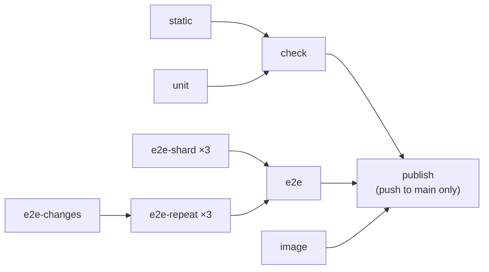

# CI/CD

How a change gets from a branch to a running instance: what GitHub Actions checks on every pull request and push to `main`, how the Docker image is built, tested and published, and how an instance picks it up. The pipeline is `.github/workflows/ci.yml`, with a nightly soak in `.github/workflows/soak.yml`. What the tests themselves cover is in [testing.md](testing.md), and setting up an instance is in the [README](../README.md#deploying).

## The pipeline

**A run starts** for every pull request and every push to `main`. The jobs are separate so that a failure in one doesn't hide the others' results, and so the slow browser tests run alongside the fast checks:



| Job            | What it does                                                                                                                                   |
| -------------- | ---------------------------------------------------------------------------------------------------------------------------------------------- |
| `static`       | Installs from the frozen lockfile, checks the Playwright image matches `@playwright/test`, then typecheck, ESLint and Prettier, and the build. |
| `unit`         | Installs `xsltproc` and `xmllint`, then runs Vitest with coverage and adds the coverage table to the run's summary.                            |
| `e2e-shard`    | The Playwright suite in three shards, inside Microsoft's Playwright container. Reports and traces are kept for 14 days.                        |
| `e2e-changes`  | On a pull request, lists the browser spec files it adds or changes.                                                                            |
| `e2e-repeat`   | Runs those spec files five more times, in three shards.                                                                                        |
| `image`        | Checks the Compose files, builds the Docker image and smoke-tests it.                                                                          |
| `check`, `e2e` | Gate jobs that report the results above under the names the branch rules require.                                                              |
| `publish`      | On a push to `main` with everything green, pushes the image to the GitHub Container Registry.                                                  |

`static` and `unit` started as one job. The tests took over three minutes of a five-minute job, with typecheck, lint and the build queued behind them, so they were split and now run in parallel.

**The browsers come in a container.** The e2e jobs run inside the official Playwright image, pinned by digest, which carries the browsers and their system libraries. Installing those with `apt` from the runner's Ubuntu mirror stalled past the timeout often enough to fail runs for reasons unrelated to the change. The image's version must match `@playwright/test` in the lockfile, and both workflows name it, so `static` checks that every copy agrees: a bump that misses one fails on the pull request rather than at night. The `unit` job still needs `apt` for `xsltproc` and `xmllint`, so that step retries and has a three-minute timeout of its own, failing fast on a stalled mirror instead of using up the whole job.

**The e2e suite is sharded** because two workers in one job took over five minutes while everything else finished in three. Shards don't stop each other on failure, so a run shows every failing test, not just the first.

## Required checks and gate jobs

A branch ruleset on `main` requires three checks by exact name: `check`, `e2e` and `image`. Splitting a job, or running it as a matrix, changes the names GitHub sees (a matrix reports `e2e-shard (1)`, `e2e-shard (2)` and so on), and a required check that never arrives blocks every merge. So the required names belong to small gate jobs:

- `check` needs `static` and `unit`, and passes only if both succeeded.
- `e2e` needs the shards and the repeat, and passes only if every shard succeeded and the repeat either succeeded or was skipped, as it is on `main` and on a pull request that changes no spec.

Both gates run with `if: always()`. Without it a gate would be skipped whenever a job it needs failed, and GitHub counts a skipped required check as passed, so a red shard could merge.

## Repeating changed specs

A browser test that fails one run in five passes a single CI run four times out of five, so it would usually merge green and fail later on someone else's change. Every pull request therefore runs the spec files it adds or changes five more times. `e2e-changes` diffs the pull request's merge commit against its first parent, the base, which needs only two commits of history, and passes the list to `e2e-repeat`. It repeats only the spec files themselves: a changed shared helper would otherwise repeat the whole suite.

This works together with Playwright's settings for CI. A failed test is retried up to twice, but only to tell a flake from a real break: `failOnFlakyTests` fails the run when a test passes only on a retry.

## The nightly soak

Repeating only the changed specs leaves a gap: a change to the app can bring a race into a spec it didn't touch, which then fails at random on `main`. `soak.yml` closes it by running the whole browser suite five times over each night, in three shards. It is scheduled at 00:17 UTC, off the hour, as GitHub drops scheduled runs under load, and can be started by hand.

A night with nothing new to find is skipped. If only docs, `.claude/`, Markdown files or the Claude Desktop extension, which no browser test touches, changed since the last soak that passed, the soak job doesn't run, and the skipped night counts as passing so the comparison carries forward. Anything that can't be checked, such as a failed fetch of the old commit, soaks anyway.

When a soak on `main` fails, a report job reads each shard's JSON results and opens one issue per failing test, or comments on that test's existing issue, so each flake is fixed and closed on its own. More than five failing tests in a night is treated as something broken, not that many flakes, and gets a single issue for the night.

## The image

The `image` job runs on every pull request, so a broken Dockerfile fails the pull request rather than the next deploy.

**The Compose files are checked first.** Several instances can run on one host, one per diver, so the job renders `compose.yml` with `docker compose config`, with and without the dive computer override, and uses `jq` to assert there are no published ports, no `container_name` and no named volumes, any of which would make two instances collide. It also asserts the override grants only what the USB cable needs: serial devices by cgroup rule, the cable's group, a read-only `/dev` without the host's submounts, all capabilities dropped and `no-new-privileges`, and that without the override an instance can't reach the cable at all.

**Then the image is built and started as Compose runs it**, with a read-only root, as the unprivileged user, on a bind-mounted data folder. `.github/scripts/smoke-image.sh` waits for the image's own healthcheck and then checks, from inside the container:

- `/api/health` reports an integrity check of `ok` on an empty log.
- Every log line is JSON naming the instance, and the startup line carries the commit the image was built from.
- The web app is served with its title and manifest from `SHYLOG_APP_NAME`, its assets load, and the service worker precaches them.
- The commit reached the bundle, so You's About doesn't say `dev`.
- The MCP endpoint answers a tool call, which proves the MCP SDK resolves in the production install.
- The time zone works from Node's own ICU data, as the slim image has no `tzdata`.
- The snapshot and restore drill commands run.
- `dctool` turns a raw download from each supported watch into exactly the committed XML, including the mandatory stops only Shylog's patched parser reports, and the libdivecomputer licence, source and patch the LGPL requires are in the image.

The build uses GitHub Actions' cache. Only pushes to `main` write it, so pull request builds can't evict the layers `publish` reuses.

## Publishing

`publish` runs only on a push to `main`, and only once `check`, `e2e` and `image` have all succeeded. Its condition names those results explicitly: a bare `if` gets an implicit `success()`, which also fails when any job further up the chain was skipped, and on a push `e2e-changes` and `e2e-repeat` always are, so publish would never run.

It rebuilds from the `image` job's cache, and with pinned base images and a frozen lockfile that is the same build as the one tested. The image is pushed to `ghcr.io` as `:latest` and `:sha-<commit>`, with the commit in the `org.opencontainers.image.revision` label so a host can tell which commit `latest` is from the image config alone. The workflow's token is read-only by default; only this job gets `packages: write`.

**Superseded runs are cancelled.** Runs are grouped per branch or pull request, and a newer push cancels the running CI, `main` included. Cutting a publish short is safe, because each tag moves only when its manifest lands: `:latest` stays on the last finished image until a newer run replaces it.

## Supply chain

- **Actions are pinned to commit SHAs**, with the version in a comment, so a moved or hijacked tag can't change what runs. Checkouts don't keep the token in the git config.
- **pnpm refuses new releases.** `pnpm-workspace.yaml` sets `minimumReleaseAge` to three days, so a hijacked release has time to be caught before it is installed, and setting it explicitly makes it strict: an install fails rather than take a release younger than that. `trustPolicy: no-downgrade` also refuses a release published with weaker provenance than an earlier one, with each reviewed exception listed beside its reason.
- **Advisories.** Dependabot raises security alerts and pull requests that fix them. `pnpm audit` often lists an advisory days before GitHub does, so it is checked by hand as well, and fixes go onto the open Dependabot pull request. Where a fixed version exists only in a newer major that dependents haven't adopted yet, a scoped `overrides` entry forces it, with a note on when to drop it.

## Deploying

CI publishes the image and stops there. It holds no credentials for any server, and the instances are reachable only over Tailscale, so nothing in GitHub could reach them anyway. Updating is a deliberate step on the home server, for each instance:

```bash
git pull && scripts/update.sh <instance>
```

`git pull` brings the clone's `compose.yml` and scripts in line with the image. `scripts/update.sh` pulls the image and does nothing if it hasn't changed. Otherwise it takes a database snapshot through the running app, starts the new image and waits up to three minutes for it to report healthy, long enough for the migrations a new server runs on startup. If it doesn't, the old image takes the tag back and starts again. A server older than the database's schema refuses to start, so a rollback after a migration fails safely: the app is left stopped, with the command to restore the snapshot taken first. The script exits 0 when updated or already current, 3 when it rolled back, and 1 when the app is left stopped. The full steps are in the README under [Updating](../README.md#updating).
