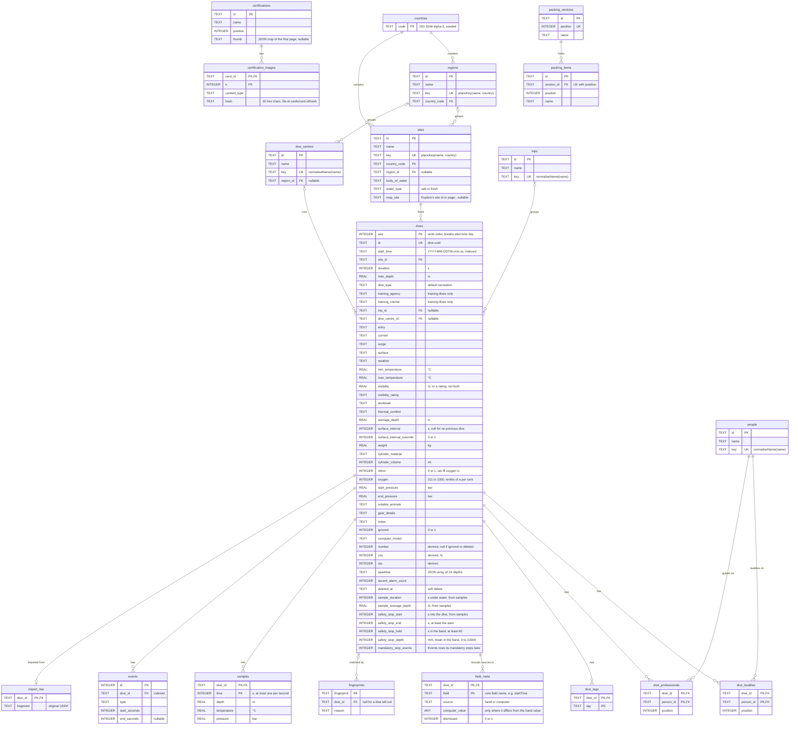

# Data model

How a dive log is stored: the database, the conventions every table follows, and the reasoning behind them. The SQLite schema is built by the migrations in `apps/server/src/db/migrations/`; this page is the map, and the diagrams at the end are updated with any migration that changes the shape. How the server writes to it is in [server.md](server.md), how the phone keeps its copy in [offline-sync.md](offline-sync.md), and how data arrives and leaves in [import.md](import.md) and [export.md](export.md). Every field and rule is listed in the [spec](planning/SPEC.md).

## Where the log lives

The SQLite database on the server is the source of truth: one file, `shylog.db`, per diver. UDDF, the open dive log format, is how data arrives (Subsurface exports and downloads from the dive computer) and how it leaves (the nightly export), but it is never where the log lives. UDDF can't hold everything Shylog records, such as which values were typed and which came from the computer, and a database gives the log constraints, transactions and a journal that a file format can't.

The phone holds a read-only copy of the log in IndexedDB, plus any new dives not yet uploaded. It never edits its copy of a synced dive directly: changes go to the server, and the copy is refreshed from it.

## The tables at a glance

| Area                            | Tables                                                                                                                                                   |
| ------------------------------- | -------------------------------------------------------------------------------------------------------------------------------------------------------- |
| Dives                           | `dives`, one row per dive with every field as a column, plus the link tables `dive_buddies`, `dive_professionals` and `dive_tags`                        |
| Profiles                        | `samples` (time, depth, temperature and tank pressure, at most one a second) and `events` (the computer's ascent alarms, surfacings and mandatory stops) |
| Places and people               | `sites`, `countries` (seeded with ISO 3166), `regions`, `people`, `dive_centres` and `trips`                                                             |
| Where values came from          | `field_meta`, `fingerprints` and `import_raw`                                                                                                            |
| Everything else the diver keeps | `certifications` and `certification_images`, `packing_sections` and `packing_items`, `settings`, `dive_computer`                                         |
| Bookkeeping                     | `ops` (the journal), `aliases`, `deleted_entities`, `import_previews` and `meta`                                                                         |

**Every field is a column.** A dive's cylinder material, cylinder volume and gas are plain columns on the dive, not rows in a shared tanks table. Changing one dive's cylinder can never change another's, and the export groups identical cylinders and gases when it writes UDDF's tanks and mixes. A person carries no role: on each dive they are either a buddy or a dive professional.

**Derived figures are stored.** The dive number, surface interval, CNS, OTU, a 24-point sparkline of the profile, the ascent alarm count and the safety stop are worked out by the server and stored on the dive. The Log, the dive's figures and the statistics then never need the samples, which stay on the server until a profile is opened or the phone downloads them in the background.

**Constraints in the schema.** Tables are `STRICT`, so SQLite refuses a value of the wrong type. Cross-field rules are `CHECK` constraints (a nitrox dive has an oxygen fraction and an air dive has none, the average depth can't exceed the maximum, a visibility is metres or a rating but not both), foreign keys are checked on every statement and never deferred, and unique keys stop two sites with the same name in one country. A bug in the server can't store a dive the rules forbid.

## Units

The database stores metric units, chosen so that nothing that is grouped or compared is a float.

| Quantity                   | Database                                    | App                           | UDDF export          |
| -------------------------- | ------------------------------------------- | ----------------------------- | -------------------- |
| Depth, visibility          | metres                                      | metres                        | metres               |
| Temperature                | °C                                          | °C                            | kelvin               |
| Pressure                   | bar                                         | bar                           | pascals              |
| Duration, surface interval | seconds                                     | minutes, or hours and minutes | seconds              |
| Cylinder volume            | millilitres (integer)                       | litres                        | cubic metres         |
| Weight                     | kg                                          | kg                            | kg                   |
| Oxygen                     | tenths of a per cent (integer; 324 = 32.4%) | % to one decimal place        | fraction from 0 to 1 |

**Integers for gas and cylinders.** The export groups every dive on 32.4% nitrox into one UDDF gas mix and every 12-litre steel cylinder into one tank. Comparing floats for that grouping would eventually split one mix in two over a rounding error, or merge 32.4% with 32%. Stored as 324 and 12000, equal values are equal. The conversions live in `packages/core` and round on the way in, so a typed 32.4 is always exactly 324.

## Time

Dive times are local wall-clock time at the site, stored as `YYYY-MM-DDTHH:mm:ss` with no zone or offset, as Subsurface stores them. A 9am dive in Vietnam is stored and shown as 9am, wherever the phone is when it is read. Ordering, dive numbers, surface intervals and CNS carry-over all work on these strings directly, and because the format is fixed width, sorting the text sorts the dives.

This would only go wrong for two dives within 48 hours in different time zones, which doesn't happen in practice. Converting to UTC would need a zone for every dive, and neither the dive computers nor Subsurface's exports record one. The shared schema accepts only a local time with whole seconds, so a zoned timestamp can't slip into storage.

Two dives can start at the same minute, so `dives` has an integer `seq` as its primary key, in the order dives were written, which breaks ties. It is a real column rather than SQLite's rowid because `VACUUM` may renumber a rowid.

## Ids

Dives, sites, regions, people, dive centres, trips, cards and packing items get their ids on the client, such as `dive-<uuid>`. A dive logged offline has its final id from the moment it is saved, so the draft, its queued upload and any site it creates all refer to each other before the server has seen any of them, and a resent upload is recognised rather than duplicated.

Every id starts with a prefix naming its kind. That makes each one a valid XML id, which can't start with a digit, so the export writes Shylog's ids into UDDF as they are and the export is stable from night to night. The prefix also catches an id passed for the wrong kind.

## Hand beats computer

A dive can be filled in from two sources: the diver typing after the dive, and the dive computer's data imported later. The diver's values win. `field_meta` holds one row per dive field with a known source, recording whether the value is `hand` or `computer`. An import never overwrites a hand value, so a corrected depth or a temperature typed by hand survives every later import.

When a hand value differs from the computer's reading, `field_meta` keeps the computer's value beside it, so the dive can show both and the diver can switch to the computer's. If they choose to keep their own, `dismissed` records it and the import stops asking. There are two deliberate exceptions: a computer's nitrox reading replaces a hand "Nitrox: no", since the computer knows the gas it was set to, and the import review can take the computer's value for a compared field on every paired dive at once. The rules are in [import.md](import.md).

Clearing a field by hand is a hand value too. When a computer value is kept, the cleared field stays a hand value of nothing, so the next import doesn't refill it.

## Rules for edits

**Nothing disappears.** Deleting a dive sets `deleted_at`, moving it to Recently deleted, from which it can always be restored. Deleted dives are never purged, so their fingerprints keep a re-import from bringing them back. A site, region, person or dive centre can be deleted only while nothing uses it, otherwise it is merged into another; a trip can be deleted, which unlinks its dives.

**Merges leave aliases.** Merging two sites (or people, regions, dive centres or trips) moves everything onto the survivor, deletes the merged-away row and records its id in `aliases`. A draft written offline that still names the old id lands on the survivor. Aliases resolve transitively, so a survivor can itself be merged later. `aliases.target_id` is deliberately not a foreign key for that reason.

**Deletes leave tombstones.** `deleted_entities` keeps the id and kind of every deleted site, person and so on, so a resent draft that names one is refused rather than recreating it, and a repeated delete changes nothing.

**Names are deduplicated.** Sites and regions are unique by normalised name within a country, and people, dive centres and trips by normalised name. Normalising ignores case, spacing, accents and curly versus straight quotes, since iOS types a curly apostrophe by default, so "Simon’s Town" and "simon's town " are one site. The server stores the normalised form in a unique `key` column, and the stored name keeps what was typed.

**Choices are keys.** Choice fields and tags store Shylog's own stable key, such as `veryMild` for the current or `night` for a tag. `packages/core` maps each key to its label in the app and to UDDF's string in the export, so a label can change without touching the data.

**Migrations are numbered and journalled.** Schema changes are TypeScript migrations run in order at startup, each preceded by a snapshot of the database and recorded in the journal; see [server.md](server.md).

## Schema

The diagrams below are the schema as built by the migrations. Columns are in database units (see [Units](#units)): metres, seconds, °C, bar, millilitres, and oxygen in tenths of a per cent. Times are local wall-clock strings with no zone.

### Logbook

Foreign keys to a dive point at `dives.id`, not its `seq` primary key.

### Bookkeeping

These tables have no foreign keys. `aliases.target_id` is deliberately not one, as a target can itself be merged away later and resolves transitively.

```mermaid
erDiagram
  meta {
    TEXT key PK "data and schema version"
    TEXT value
  }
  settings {
    INTEGER id PK "always 1"
    TEXT diver_name
    REAL max_po2 "bar, default 1.4"
    TEXT new_dive_defaults "JSON"
  }
  aliases {
    TEXT id PK "merged-away id"
    TEXT kind
    TEXT target_id
  }
  deleted_entities {
    TEXT id PK
    TEXT kind
  }
  ops {
    INTEGER seq PK "AUTOINCREMENT, never reused"
    TEXT op_id UK "client op id, drafts only"
    TEXT type
    TEXT payload "JSON"
    TEXT applied_at
  }
  import_previews {
    TEXT id PK
    TEXT data_version
    TEXT created_at
    TEXT expires_at "seven days on"
    TEXT preview "JSON"
  }
  dive_computer {
    INTEGER id PK "always 1, at most one watch"
    TEXT serial
    TEXT model
    TEXT marker "newest applied dive's start, watch clock"
    TEXT last_download_at
  }
```

